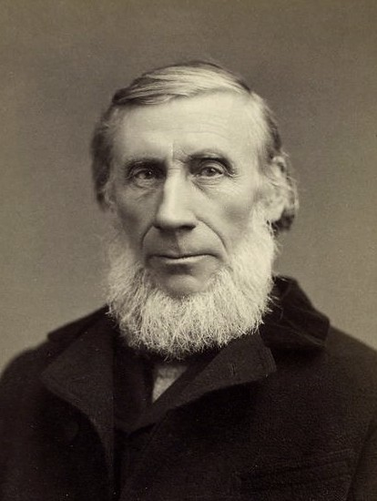

# 约翰·廷德尔

**英文名：** John Tyndall

**生卒：** 1820年8月2日 — 1893年12月4日

**主要领域：** 热辐射、大气物理、光学

肖像的作者、拍摄或创作年代及具体形式见图片来源。

## 生平简介

爱尔兰出生的英国实验物理学家，长期在伦敦皇家研究所工作，亦以登山和科学讲演闻名。他研究热辐射、光散射和磁性，并通过面向公众的演示推广实验科学，连接了基础物理与大气研究。

## 对物理的主要贡献

- 测量不同气体对红外辐射的吸收，揭示水汽和二氧化碳等的作用
- 研究胶体和悬浮颗粒对光的散射，即廷德尔效应
- 研究抗磁性、辐射热传递及声传播

## 肖像来源与许可

- 来源：[John_Tyndall_portrait_mid_career.jpg](https://commons.wikimedia.org/wiki/File:John_Tyndall_portrait_mid_career.jpg)
- 作者／署名：Tucker Collection
- 许可：Public domain
- 本地文件：[5c0613b83137cfd63b28.jpg](../portraits/5c0613b83137cfd63b28.jpg)
- 原始来源说明：New York Public Library Archives

## 资料来源

- [John Tyndall — Wikipedia（生卒日期与人物概述）](https://en.wikipedia.org/wiki/John_Tyndall)

资料整理日期：2026-10-26。
