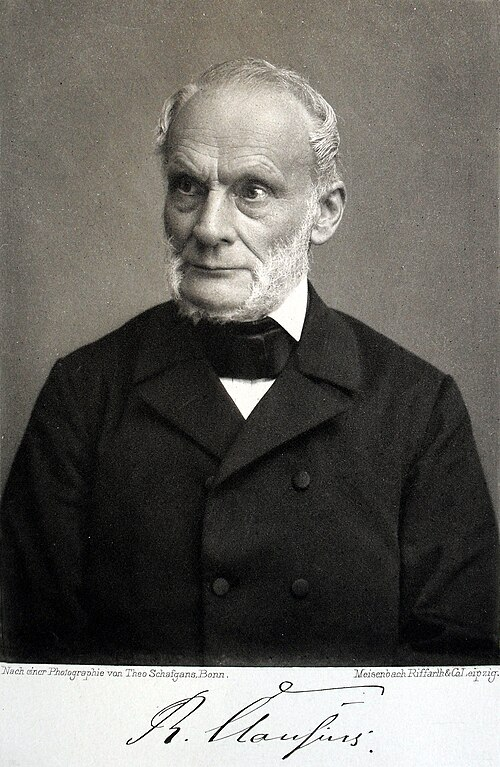

# 鲁道夫·克劳修斯

**英文名：** Rudolf Clausius

**生卒：** 1822年1月2日 — 1888年8月24日

**主要领域：** 热力学、统计物理、气体动理论

肖像的作者、拍摄或创作年代及具体形式见图片来源。

## 生平简介

德国理论物理学家，曾在柏林、苏黎世、维尔茨堡和波恩任教。他重新审视卡诺热机理论，把能量守恒和热过程方向性区分开来，创立熵的概念，成为热力学与分子运动理论的主要奠基者。

## 对物理的主要贡献

- 建立热力学第二定律的重要表述，阐明热过程的方向性
- 引入熵概念并给出其数学定义
- 发展气体动理论，提出平均自由程并建立维里定理

## 肖像来源与许可

- 来源：[Rudolf_Clausius_01.jpg](https://commons.wikimedia.org/wiki/File:Rudolf_Clausius_01.jpg)
- 作者／署名：Picture taken by Theo Schafgans (1859–1907), Bonn; heliogravüre by Meisenbach, Riffarth & Co. Berlin. Scanned, image processed and uploaded by Kuebi = Armin Kübelbeck
- 许可：[Public domain](https://commons.wikimedia.org/wiki/File:Rudolf_Clausius_01.jpg)
- 本地文件：[760d65f5a0f64c37a6a7.jpg](../portraits/760d65f5a0f64c37a6a7.jpg)
- 原始来源说明：Zeitschrift für Physikalische Chemie, Band 21, von 1896

## 资料来源

- [Rudolf Clausius — MacTutor, University of St Andrews](https://mathshistory.st-andrews.ac.uk/Biographies/Clausius/)
- [Rudolf Clausius — Wikipedia（生卒日期与人物概述）](https://en.wikipedia.org/wiki/Rudolf_Clausius)

资料整理日期：2026-10-26。
