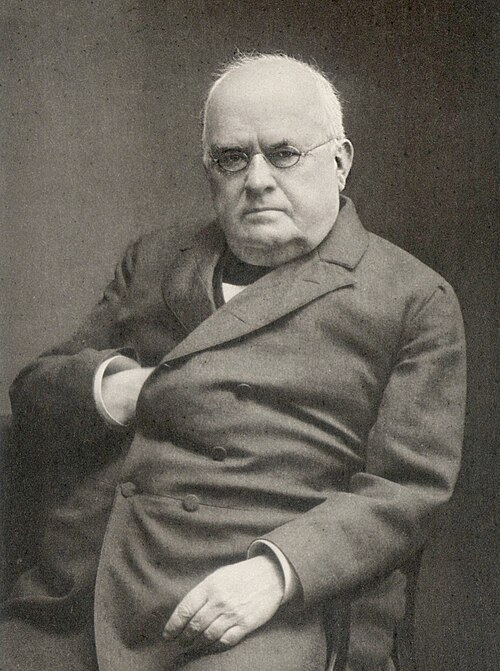

# 约翰·威廉·希托夫

**英文名：** Johann Wilhelm Hittorf

**生卒：** 1824年3月27日 — 1914年11月28日

**主要领域：** 电化学、气体放电、光谱学

肖像的作者、拍摄或创作年代及具体形式见图片来源。

## 生平简介

德国物理学家和化学家，长期在明斯特的学院与大学任教，早年受普吕克尔指导。他把电化学中的物质输运和低压放电中的射线行为都转化为定量实验，并建设当地物理实验教学。

## 对物理的主要贡献

- 建立测量电解质离子迁移数的方法
- 研究阴极射线的直线传播和物体形成的阴影
- 与普吕克尔研究气体光谱，推动放电物理的发展

## 肖像来源与许可

- 来源：[Hittorf_portrait_from_Festschrift_1904_(cropped).jpg](https://commons.wikimedia.org/wiki/File:Hittorf_portrait_from_Festschrift_1904_%28cropped%29.jpg)
- 作者／署名：Unknown author
- 许可：[Public domain](https://en.wikipedia.org/wiki/en:Creative_Commons)
- 本地文件：[637fa51a935de827ce15-83fad3f19d.jpg](../portraits/637fa51a935de827ce15-83fad3f19d.jpg)
- 原始来源说明：Special issue in honour of the 80th anniversary of Johann Wilhelm Hittorf's birth. Leipzig: Barth 1904. [1]

## 资料来源

- [Wilhelm Hittorf — University of Münster, Department of Physics history](https://www.uni-muenster.de/Physik/en/der_fachbereich/geschichte.html)
- [Johann Wilhelm Hittorf — Wikipedia biography](https://en.wikipedia.org/wiki/Johann_Wilhelm_Hittorf)

资料整理日期：2026-10-26。
