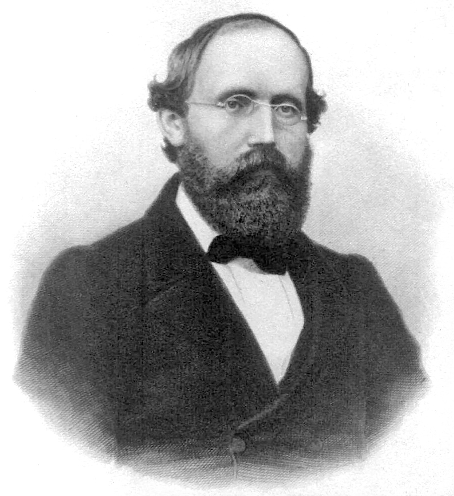

# 伯恩哈德·黎曼

**英文名：** Bernhard Riemann

**生卒：** 1826年9月17日 — 1866年7月20日

**主要领域：** 数学物理、几何与引力

肖像的作者、拍摄或创作年代及具体形式见图片来源。

## 生平简介

德国数学家，主要在哥廷根求学与工作，因病英年早逝。他研究分析、几何与复函数，在短暂生涯中提出以度量刻画空间的思想；这些工作后来成为广义相对论和现代场论的重要数学基础。

## 对物理的主要贡献

- 创立黎曼几何，把空间的内在度量与曲率作为研究对象
- 发展多值函数与黎曼曲面理论，提供数学物理的重要分析工具
- 研究流体与波动等问题，其几何思想后来成为引力理论的基础

## 史料说明

- 黎曼未建立广义相对论
- 这里记录的是其数学工作对后世物理的基础作用。

## 肖像来源与许可

- 来源：[Georg_Friedrich_Bernhard_Riemann.jpeg](https://commons.wikimedia.org/wiki/File:Georg_Friedrich_Bernhard_Riemann.jpeg)
- 作者／署名：见原图页面
- 许可：[Public domain](https://commons.wikimedia.org/wiki/File:Georg_Friedrich_Bernhard_Riemann.jpeg)
- 本地文件：[49c360e7f7e47a6a1b81.jpeg](../portraits/49c360e7f7e47a6a1b81.jpeg)
- 原始来源说明：http://www.sil.si.edu/digitalcollections/hst/scientific-identity/explore.htm according to the German Wikipedia.

## 资料来源

- [Bernhard Riemann — MacTutor, University of St Andrews](https://mathshistory.st-andrews.ac.uk/Biographies/Riemann/)
- [Bernhard Riemann — Wikipedia（生卒日期与人物概述）](https://en.wikipedia.org/wiki/Bernhard_Riemann)

资料整理日期：2026-10-26。
