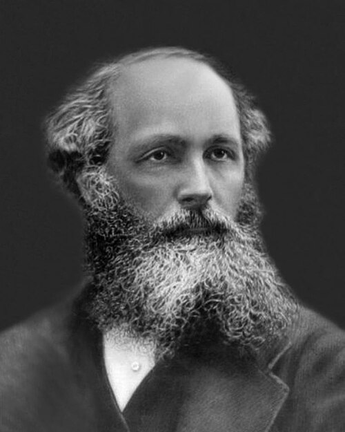

# 詹姆斯·克拉克·麦克斯韦

**英文名：** James Clerk Maxwell

**生卒：** 1831年6月13日 — 1879年11月5日

**主要领域：** 电磁学、统计物理、光学

肖像的作者、拍摄或创作年代及具体形式见图片来源。

## 生平简介

苏格兰物理学家，曾在阿伯丁与伦敦任教，后成为剑桥首任卡文迪许物理学教授并筹建实验室。他将法拉第的场观念转化为数学理论，同时研究分子运动、颜色视觉与土星环，是经典物理的核心奠基者。

## 对物理的主要贡献

- 建立经典电磁场理论，预言电磁波并把光解释为电磁现象
- 建立气体分子速率分布，推动统计物理与输运理论
- 研究三原色视觉与土星环稳定性，并推动卡文迪许实验室建设

## 肖像来源与许可

- 来源：[James-Clerk-Maxwell-1831-1879.jpg](https://commons.wikimedia.org/wiki/File:James-Clerk-Maxwell-1831-1879.jpg)
- 作者／署名：Unknown author
- 许可：[Public domain](https://commons.wikimedia.org/wiki/File:James-Clerk-Maxwell-1831-1879.jpg)
- 本地文件：[3afa3f9d758d97952f52.jpg](../portraits/3afa3f9d758d97952f52.jpg)
- 原始来源说明：https://www.researchgate.net/figure/James-Clerk-Maxwell-1831-1879_fig1_360164096

## 资料来源

- [James Clerk Maxwell — MacTutor, University of St Andrews](https://mathshistory.st-andrews.ac.uk/Biographies/Maxwell/)
- [James Clerk Maxwell — Wikipedia（生卒日期与人物概述）](https://en.wikipedia.org/wiki/James_Clerk_Maxwell)

资料整理日期：2026-10-26。
