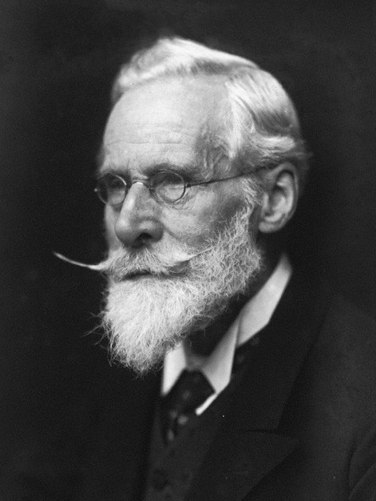

# 威廉·克鲁克斯

**英文名：** William Crookes

**生卒：** 1832年6月17日 — 1919年4月4日

**主要领域：** 气体放电、真空物理、光谱学

肖像的作者、拍摄或创作年代及具体形式见图片来源。

## 生平简介

英国化学家和物理学家，主要在私人实验室研究，亦创办科学刊物。他改进真空技术并研究低压气体放电，发明辐射计，对十九世纪末阴极射线与物质结构实验产生影响，也曾卷入有争议的通灵研究。

## 对物理的主要贡献

- 改进高真空放电管，系统研究阴极射线的性质
- 发明克鲁克斯辐射计，促进稀薄气体与辐射效应研究
- 通过光谱分析发现铊，连接化学分析与光谱实验

## 肖像来源与许可

- 来源：[Sir_William_Crookes_1906.jpg](https://commons.wikimedia.org/wiki/File:Sir_William_Crookes_1906.jpg)
- 作者／署名：George Charles Beresford (1864-1938)
- 许可：[Public domain](https://commons.wikimedia.org/wiki/File:Sir_William_Crookes_1906.jpg)
- 本地文件：[359b829fb4888acaf273.jpg](../portraits/359b829fb4888acaf273.jpg)
- 原始来源说明：[1]

## 资料来源

- [William Crookes — Wikipedia（生卒日期与人物概述）](https://en.wikipedia.org/wiki/William_Crookes)

资料整理日期：2026-10-26。
