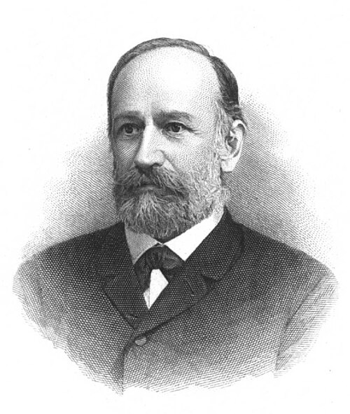

# 约瑟夫·斯特藩

**英文名：** Jožef Stefan

**生卒：** 1835年3月24日 — 1893年1月7日

**主要领域：** 热辐射、热传导、相变物理

肖像的作者、拍摄或创作年代及具体形式见图片来源。

## 生平简介

出生于克恩顿的斯洛文尼亚裔奥地利物理学家，长期在维也纳大学工作，曾指导玻尔兹曼。他研究热辐射、气体输运和相变，善于把实验数据概括为定量规律，对热物理的发展有持久影响。

## 对物理的主要贡献

- 从实验资料提出黑体辐射功率与绝对温度四次方成正比的斯特藩定律
- 研究物质扩散和热传导
- 研究冻结与熔化界面运动，形成斯特藩问题

## 肖像来源与许可

- 来源：[Jozef_Stefan.jpg](https://commons.wikimedia.org/wiki/File:Jozef_Stefan.jpg)
- 作者／署名：K. Schönbauer
- 许可：Public domain
- 本地文件：[de1db057c2b81488f50b.jpg](../portraits/de1db057c2b81488f50b.jpg)
- 原始来源说明：page (image)

## 资料来源

- [Jožef Stefan — Wikipedia（生卒日期与人物概述）](https://en.wikipedia.org/wiki/Jo%C5%BEef_Stefan)

资料整理日期：2026-10-26。
