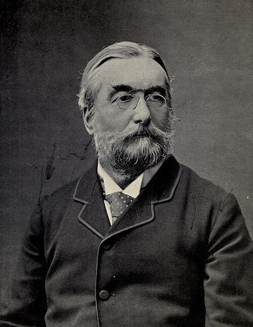

# 诺曼·洛克耶

**英文名：** Norman Lockyer

**生卒：** 1836年5月17日 — 1920年8月16日

**主要领域：** 太阳物理、光谱学、天体物理

肖像的作者、拍摄或创作年代及具体形式见图片来源。

## 生平简介

英国天文学家和科学组织者，早年任公务员，后集中从事太阳光谱观测，并创办《自然》杂志。他把光谱仪用于研究日珥和太阳大气，晚年建立天文台，推动了天体物理观测和科学交流。

## 对物理的主要贡献

- 利用太阳光谱研究日珥及太阳大气结构
- 独立观察到太阳光谱中此前未知的黄色谱线，并参与将其解释为新元素氦
- 发展天体光谱观测方法，推动太阳物理研究

## 史料说明

- 氦的太阳光谱发现涉及让森、洛克耶等人的独立工作，不能归于单一发现者。

## 肖像来源与许可

- 来源：[Picture_of_Norman_Lockyer.jpg](https://commons.wikimedia.org/wiki/File:Picture_of_Norman_Lockyer.jpg)
- 作者／署名：Stereoscopic Co.
- 许可：[Public domain](https://commons.wikimedia.org/wiki/File:Picture_of_Norman_Lockyer.jpg)
- 本地文件：[7d3d1d48443b48e0bf07.jpg](../portraits/7d3d1d48443b48e0bf07.jpg)
- 原始来源说明：Notables of Britain: https://archive.org/stream/notablesofbritai00londuoft#page/156/mode/2up

## 资料来源

- [Norman Lockyer — Wikipedia（生卒日期与人物概述）](https://en.wikipedia.org/wiki/Norman_Lockyer)

资料整理日期：2026-10-26。
