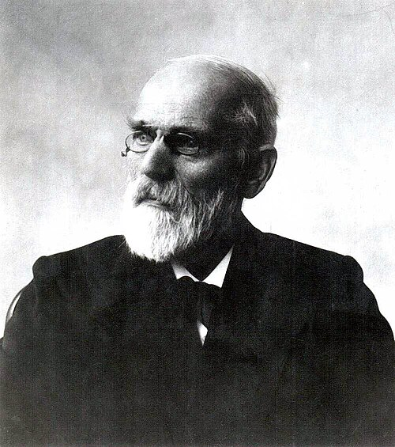

# 约翰内斯·范德瓦耳斯

**英文名：** Johannes Diderik van der Waals

**生卒：** 1837年11月23日 — 1923年3月8日

**主要领域：** 热力学、统计物理

肖像的作者、拍摄或创作年代及具体形式见图片来源。

## 生平简介

约翰内斯·范德瓦耳斯出生于Leiden, the Netherlands，主要从事热力学、统计物理研究。诺贝尔奖资料所列获奖时任职机构为Amsterdam University。其代表成果包括建立考虑分子体积和分子间作用的实际气体状态方程，获1910年诺贝尔物理学奖。

## 对物理的主要贡献

- 建立考虑分子体积和分子间作用的实际气体状态方程
- 解释气液连续性与临界现象

**诺贝尔物理学奖：** 1910

## 肖像来源与许可

- 来源：[Johannes_Diderik_van_der_Waals.jpg](https://commons.wikimedia.org/wiki/File:Johannes_Diderik_van_der_Waals.jpg)
- 作者／署名：Unknown author
- 许可：Public domain
- 本地文件：[abf19e8dae4a290155c6.jpg](../portraits/abf19e8dae4a290155c6.jpg)
- 原始来源说明：Copied from w:Image:Johannes Diderik van der Waals.jpg, originally from here.

## 资料来源

- [Johannes Diderik van der Waals - Facts](https://www.nobelprize.org/prizes/physics/1910/waals/facts/)
- [Nobel Prize official laureate API, id 15](https://api.nobelprize.org/2.1/laureate/15)
- [Wikipedia: Johannes Diderik van der Waals](https://en.wikipedia.org/wiki/Johannes_Diderik_van_der_Waals)

资料整理日期：2026-10-26。
