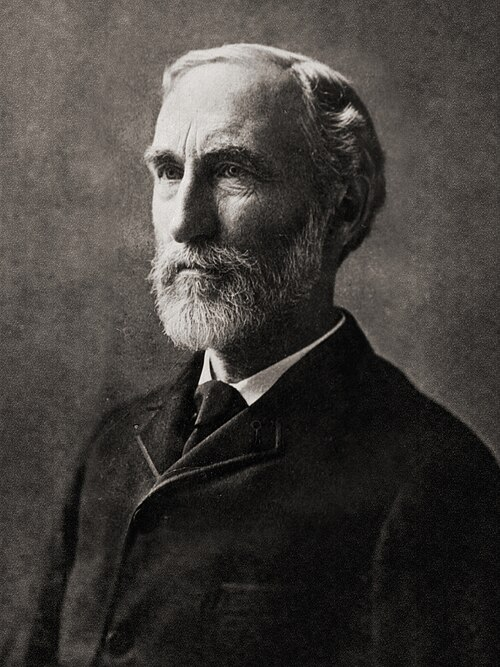

# 约西亚·威拉德·吉布斯

**英文名：** Josiah Willard Gibbs

**生卒：** 1839年2月11日 — 1903年4月28日

**主要领域：** 热力学、统计物理、数学物理

肖像的作者、拍摄或创作年代及具体形式见图片来源。

## 生平简介

美国数学物理学家，几乎整个学术生涯都在耶鲁大学度过。他以简洁而抽象的方式研究热力学、相平衡与统计系综，早期成果传播较慢，后来成为现代统计物理、物理化学和工程热力学的共同基础。

## 对物理的主要贡献

- 建立化学势、自由能和多相平衡的系统热力学框架，提出相律
- 以统计系综组织统计力学，系统阐述正则与巨正则等描述
- 发展现代向量分析记号和方法

## 肖像来源与许可

- 来源：[Josiah_Willard_Gibbs_-from_MMS-.jpg](https://commons.wikimedia.org/wiki/File:Josiah_Willard_Gibbs_-from_MMS-.jpg)
- 作者／署名：Unknown. Uploaded by Serge Lachinov (обработка для wiki)
- 许可：Public domain
- 本地文件：[d8c5f2dedee4237949da.jpg](../portraits/d8c5f2dedee4237949da.jpg)
- 原始来源说明：Frontispiece of The Scientific Papers of J. Willard Gibbs, in two volumes, eds. H. A. Bumstead and R. G. Van Name, (London and New York: Longmans, Green, and Co., 1906)

## 资料来源

- [Josiah Willard Gibbs — MacTutor, University of St Andrews](https://mathshistory.st-andrews.ac.uk/Biographies/Gibbs/)
- [Josiah Willard Gibbs — Wikipedia（生卒日期与人物概述）](https://en.wikipedia.org/wiki/Josiah_Willard_Gibbs)

资料整理日期：2026-10-26。
