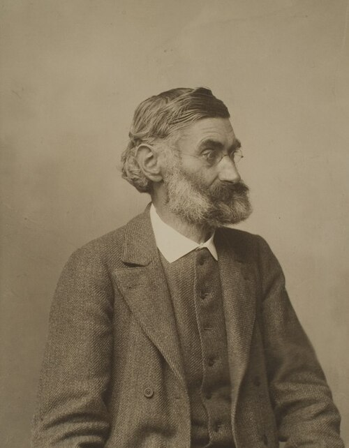

# 恩斯特·阿贝

**英文名：** Ernst Abbe

**生卒：** 1840年1月23日 — 1905年1月14日

**主要领域：** 物理光学、显微成像、计量学

肖像的作者、拍摄或创作年代及具体形式见图片来源。

## 生平简介

德国物理学家和光学仪器设计者，长期在耶拿与卡尔·蔡司及奥托·肖特合作。他把衍射理论、玻璃材料和镜头制造结合起来，使显微镜设计建立在可计算的物理基础上，同时参与企业与科研组织改革。

## 对物理的主要贡献

- 建立显微镜成像的衍射理论，阐明数值孔径与分辨率的关系
- 发展阿贝正弦条件等像差控制准则，改进高性能物镜
- 设计折射率测量等精密光学仪器

## 肖像来源与许可

- 来源：[Ernst_Abbe_(HeidICON_29803)_(cropped).jpg](https://commons.wikimedia.org/wiki/File:Ernst_Abbe_%28HeidICON_29803%29_%28cropped%29.jpg)
- 作者／署名：Bräunlich & Tesch, Inh. Emil Tesch, Hofphotograph Jena
- 许可：[CC BY-SA 4.0](https://commons.wikimedia.org/wiki/File:Ernst_Abbe_%28HeidICON_29803%29_%28cropped%29.jpg)
- 本地文件：[8082e58bc52322f4c113.jpg](../portraits/8082e58bc52322f4c113.jpg)
- 原始来源说明：HeidICON via Prometheus

## 资料来源

- [Ernst Abbe — MacTutor, University of St Andrews](https://mathshistory.st-andrews.ac.uk/Biographies/Abbe/)
- [Ernst Abbe — Wikipedia（生卒日期与人物概述）](https://en.wikipedia.org/wiki/Ernst_Abbe)

资料整理日期：2026-10-26。
