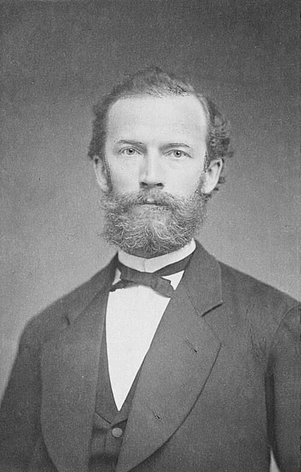

# 弗里德里希·科尔劳施

**英文名：** Friedrich Kohlrausch

**生卒：** 1840年10月14日 — 1910年1月17日

**主要领域：** 电化学、精密测量、计量学

肖像的作者、拍摄或创作年代及具体形式见图片来源。

## 生平简介

德国实验物理学家，曾在维尔茨堡和斯特拉斯堡任教，后主持德国物理技术研究所。他将高精度物理量测量、实验教学与电解质研究结合，编写的实验物理教材影响了数代研究者。

## 对物理的主要贡献

- 提出电解质无限稀释条件下离子独立迁移的规律
- 发展交流电桥等精密电导测量方法
- 推动电学标准、计量制度和系统实验教学的发展

## 肖像来源与许可

- 来源：[Friedrich_Kohlrausch.jpg](https://commons.wikimedia.org/wiki/File:Friedrich_Kohlrausch.jpg)
- 作者／署名：Otto Patzig (1822-1885), Würzburg [2]
- 许可：[Public domain](https://commons.wikimedia.org/wiki/File:Friedrich_Kohlrausch.jpg)
- 本地文件：[1c9aa4137dc26aa22f27-42024b48d5.jpg](../portraits/1c9aa4137dc26aa22f27-42024b48d5.jpg)
- 原始来源说明：[1]

## 资料来源

- [Friedrich Kohlrausch — University of Würzburg Archives](https://www.uni-wuerzburg.de/en/uniarchiv/personalities/plaques-in-honour-of-eminent-scholars/friedrich-kohlrausch/)
- [Friedrich Kohlrausch — Wikipedia biography](https://en.wikipedia.org/wiki/Friedrich_Kohlrausch_%28physicist%29)

资料整理日期：2026-10-26。
