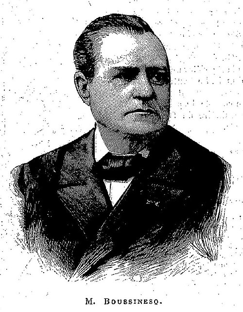

# 约瑟夫·布西涅斯克

**英文名：** Joseph Boussinesq

**生卒：** 1842年3月13日 — 1929年2月19日

**主要领域：** 流体力学、波动、连续介质力学

肖像的作者、拍摄或创作年代及具体形式见图片来源。

## 生平简介

法国数学家和物理学家，曾在里尔与巴黎任教。他研究水波、弹性、热传导和湍流，把偏微分方程用于复杂连续介质问题；许多以其命名的近似至今仍用于海洋、大气和工程流体计算。

## 对物理的主要贡献

- 提出浮力流中的布西涅斯克近似，简化密度变化的处理
- 建立浅水非线性长波的布西涅斯克方程
- 发展湍流涡黏性思想及弹性接触问题的理论

## 肖像来源与许可

- 来源：[Joseph_Boussinesq.jpg](https://commons.wikimedia.org/wiki/File:Joseph_Boussinesq.jpg)
- 作者／署名：Unknown author
- 许可：Public domain
- 本地文件：[dd55181ca47c28d43dfe.jpg](../portraits/dd55181ca47c28d43dfe.jpg)
- 原始来源说明：http://gallica.bnf.fr/ark:/12148/bpt6k57425961/f152.image.r=boussinesq.langEN

## 资料来源

- [Joseph Boussinesq — MacTutor, University of St Andrews](https://mathshistory.st-andrews.ac.uk/Biographies/Boussinesq/)
- [Joseph Boussinesq — Wikipedia（生卒日期与人物概述）](https://en.wikipedia.org/wiki/Joseph_Boussinesq)

资料整理日期：2026-10-26。
