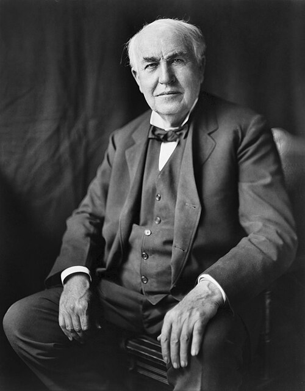

# 托马斯·爱迪生

**英文名：** Thomas Edison

**生卒：** 1847年2月11日 — 1931年10月18日

**主要领域：** 电气技术、热电子发射、应用物理

肖像的作者、拍摄或创作年代及具体形式见图片来源。

## 生平简介

美国发明家和工业研究组织者，早年从事电报工作，后建立门洛帕克和西奥兰治实验室。他主要贡献于电气技术与应用研究，通过团队化实验改进照明、供电、录音和影像装置，并观察到真空灯泡中的电子发射现象。

## 对物理的主要贡献

- 系统改进白炽照明和配套直流供电系统，推进电能的工程应用
- 观察真空灯泡中单向导电的爱迪生效应，成为热电子发射研究的早期现象
- 建立以团队实验和器件改进为中心的工业研究模式

## 史料说明

- 主要身份为发明家和工程研究组织者
- 电灯、电影等技术均有多位先驱，不作单一发明者归属。

## 肖像来源与许可

- 来源：[Thomas_Edison2.jpg](https://commons.wikimedia.org/wiki/File:Thomas_Edison2.jpg)
- 作者／署名：Louis Bachrach, Bachrach Studios, restored by Michel Vuijlsteke
- 许可：Public domain
- 本地文件：[37c67f7f5d793cb12fd3.jpg](../portraits/37c67f7f5d793cb12fd3.jpg)

## 资料来源

- [Thomas Edison — Wikipedia（生卒日期与人物概述）](https://en.wikipedia.org/wiki/Thomas_Edison)

资料整理日期：2026-10-26。
