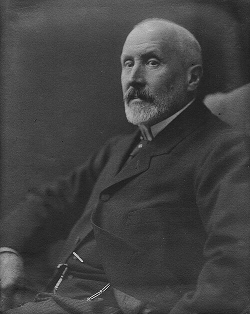

# 洛兰德·厄特沃什

**英文名：** Loránd Eötvös

**生卒：** 1848年7月27日 — 1919年4月8日

**主要领域：** 引力实验、地球物理、表面物理

肖像的作者、拍摄或创作年代及具体形式见图片来源。

## 生平简介

匈牙利物理学家，长期在布达佩斯大学任教并参与教育管理。他先研究液体表面张力，后发展高灵敏扭秤进行重力测量；其惯性质量与引力质量比较实验成为等效原理的重要实验基础。

## 对物理的主要贡献

- 使用高精度扭秤比较不同物质的惯性质量和引力质量比例
- 发展重力梯度测量，促进地球物理勘探
- 提出描述液体表面张力随温度变化的厄特沃什关系

## 肖像来源与许可

- 来源：[Eötvös_Loránd.jpg](https://commons.wikimedia.org/wiki/File:E%C3%B6tv%C3%B6s_Lor%C3%A1nd.jpg)
- 作者／署名：Aladár Székely (1870–1940)
- 许可：[Public domain](https://commons.wikimedia.org/wiki/File:E%C3%B6tv%C3%B6s_Lor%C3%A1nd.jpg)
- 本地文件：[f5ef9f5acbba1d85ba73.jpg](../portraits/f5ef9f5acbba1d85ba73.jpg)
- 原始来源说明：https://gyujtemenyek.mnm.hu/hu/record/-/record/MNMMUSEUM1195273

## 资料来源

- [Loránd Eötvös — MacTutor, University of St Andrews](https://mathshistory.st-andrews.ac.uk/Biographies/Eotvos/)
- [Loránd Eötvös — Wikipedia（生卒日期与人物概述）](https://en.wikipedia.org/wiki/Lor%C3%A1nd_E%C3%B6tv%C3%B6s)

资料整理日期：2026-10-26。
