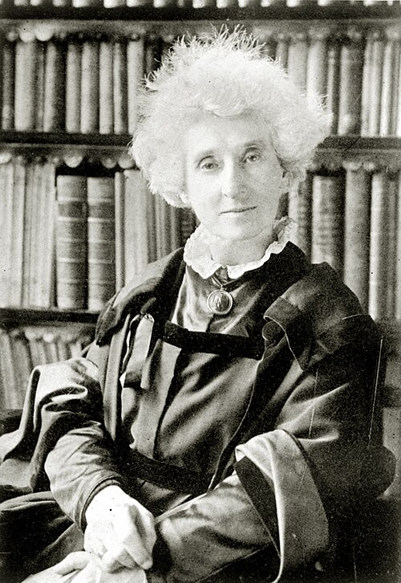

# 玛格丽特·林赛·哈金斯

**英文名：** Margaret Lindsay Huggins

**生卒：** 1848年8月14日 — 1915年3月24日

**主要领域：** 天体物理、光谱学、科学摄影

肖像的作者、拍摄或创作年代及具体形式见图片来源。

## 生平简介

爱尔兰出生的英国天文学家，婚后与威廉·哈金斯在私人天文台长期合作。她熟悉摄影和观测实践，参与恒星与星云光谱记录、仪器操作和成果整理，是十九世纪天体光谱摄影的重要参与者。

## 对物理的主要贡献

- 与威廉·哈金斯合作发展天体光谱摄影，记录恒星和星云的物理信息
- 参与紫外恒星光谱及天体发射光谱研究
- 共同整理和发表天体光谱图谱，提高观测结果的可比较性

## 肖像来源与许可

- 来源：[Margaret_Lindsay_Huggins.jpg](https://commons.wikimedia.org/wiki/File:Margaret_Lindsay_Huggins.jpg)
- 作者／署名：Unknown author
- 许可：Public domain
- 本地文件：[007ea457e56dae0bd5ae.jpg](../portraits/007ea457e56dae0bd5ae.jpg)
- 原始来源说明：Huggins, Margaret Lindsay Murray, The University of Chicago Photographic Archive

## 资料来源

- [Margaret Lindsay Huggins — Wikipedia（生卒日期与人物概述）](https://en.wikipedia.org/wiki/Margaret_Lindsay_Huggins)

资料整理日期：2026-10-26。
