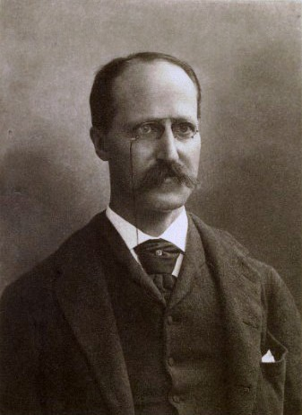

# 亨利·奥古斯都·罗兰

**英文名：** Henry Augustus Rowland

**生卒：** 1848年11月27日 — 1901年4月16日

**主要领域：** 电磁学、光谱学、计量学

肖像的作者、拍摄或创作年代及具体形式见图片来源。

## 生平简介

美国实验物理学家，长期在约翰斯·霍普金斯大学任教，推动美国物理研究的专业化。他研究电磁现象、热学计量与光谱仪器，以精密刻制衍射光栅和太阳光谱测量尤其著称。

## 对物理的主要贡献

- 用运动带电圆盘实验检验运动电荷产生磁场
- 发明凹面衍射光栅并提高光栅刻制精度，推动高分辨光谱学
- 精密研究热功当量及太阳光谱波长

## 肖像来源与许可

- 来源：[Rowland_Henry.jpg](https://commons.wikimedia.org/wiki/File:Rowland_Henry.jpg)
- 作者／署名：Henry Rowland
- 许可：Public domain
- 本地文件：[2d16bfd445f614461da1.jpg](../portraits/2d16bfd445f614461da1.jpg)
- 原始来源说明：Frontispiece of The Physical Papers of Henry Augustus Rowland

## 资料来源

- [Henry Augustus Rowland — Wikipedia（生卒日期与人物概述）](https://en.wikipedia.org/wiki/Henry_Augustus_Rowland)

资料整理日期：2026-10-26。
