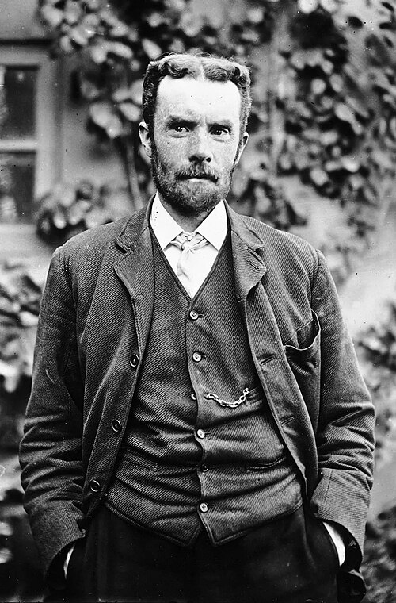

# 奥利弗·赫维赛德

**英文名：** Oliver Heaviside

**生卒：** 1850年5月18日 — 1925年2月3日

**主要领域：** 电磁学、电气物理、数学物理

肖像的作者、拍摄或创作年代及具体形式见图片来源。

## 生平简介

英国物理学家和电气理论研究者，早年从事电报工作，后主要独立研究。他用向量语言重写电磁理论，并研究电缆传输、阻抗和运算方法；生前并非始终获得学界理解，后来对电磁工程影响深远。

## 对物理的主要贡献

- 将麦克斯韦电磁理论整理成现代常用的向量方程形式
- 发展传输线理论、无畸变条件与阻抗方法
- 提出高空电离层可反射无线电波的思想，并推广运算微积分

## 肖像来源与许可

- 来源：[Oheaviside.jpg](https://commons.wikimedia.org/wiki/File:Oheaviside.jpg)
- 作者／署名：Unknown author
- 许可：Public domain
- 本地文件：[6523ff1cb53bcb59da84.jpg](../portraits/6523ff1cb53bcb59da84.jpg)
- 原始来源说明：IET Archive

## 资料来源

- [Oliver Heaviside — MacTutor, University of St Andrews](https://mathshistory.st-andrews.ac.uk/Biographies/Heaviside/)
- [Oliver Heaviside — Wikipedia（生卒日期与人物概述）](https://en.wikipedia.org/wiki/Oliver_Heaviside)

资料整理日期：2026-10-26。
