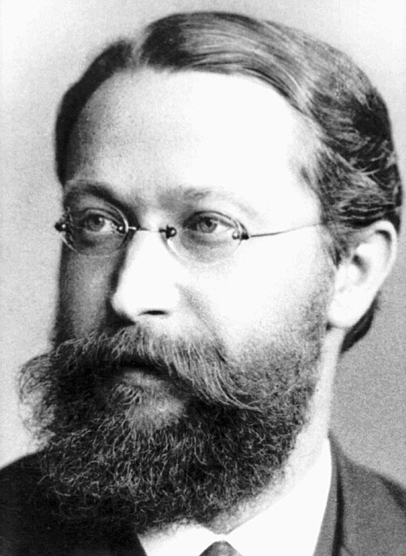

# 卡尔·费迪南德·布劳恩

**英文名：** Karl Ferdinand Braun

**生卒：** 1850年6月6日 — 1918年4月20日

**主要领域：** 电磁学、电子仪器

肖像的作者、拍摄或创作年代及具体形式见图片来源。

## 生平简介

卡尔·费迪南德·布劳恩出生于Fulda, Hesse-Kassel (now Germany)，主要从事电磁学、电子仪器研究。诺贝尔奖资料所列获奖时任职机构为Strasbourg University。其代表成果包括改进无线电发射电路和耦合调谐方法，获1909年诺贝尔物理学奖。

## 对物理的主要贡献

- 改进无线电发射电路和耦合调谐方法
- 发展阴极射线示波管，为电子测量仪器奠定基础

**诺贝尔物理学奖：** 1909

## 肖像来源与许可

- 来源：[Ferdinand_Braun.jpg](https://commons.wikimedia.org/wiki/File:Ferdinand_Braun.jpg)
- 作者／署名：见原图页面
- 许可：Public domain
- 本地文件：[4a6590ca349bc2189415.jpg](../portraits/4a6590ca349bc2189415.jpg)

## 资料来源

- [Ferdinand Braun - Facts](https://www.nobelprize.org/prizes/physics/1909/braun/facts/)
- [Nobel Prize official laureate API, id 14](https://api.nobelprize.org/2.1/laureate/14)
- [Wikipedia: Karl Ferdinand Braun](https://en.wikipedia.org/wiki/Karl_Ferdinand_Braun)

资料整理日期：2026-10-26。
