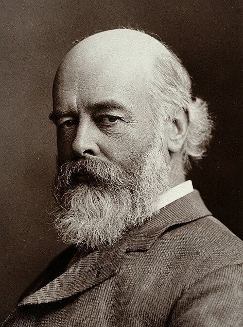

# 奥利弗·洛奇

**英文名：** Oliver Lodge

**生卒：** 1851年6月12日 — 1940年8月22日

**主要领域：** 电磁学、无线电物理、实验物理

肖像的作者、拍摄或创作年代及具体形式见图片来源。

## 生平简介

英国物理学家，曾在利物浦任教，后任伯明翰大学首任校长。他研究电磁波、放电与无线电接收，在赫兹实验之后推动电磁波通信技术，也因对以太和心灵研究的兴趣而成为公众人物。

## 对物理的主要贡献

- 研究并演示赫兹电磁波，改进无线电接收和检波装置
- 发展调谐无线电通信的方法
- 研究电磁波传播及运动介质问题，参与检验以太相关理论

## 肖像来源与许可

- 来源：[Oliver_Joseph_Lodge3.jpg](https://commons.wikimedia.org/wiki/File:Oliver_Joseph_Lodge3.jpg)
- 作者／署名：Lafayette Ltd.
- 许可：[CC BY 4.0](https://creativecommons.org/licenses/by/4.0)
- 本地文件：[3a26e8279e4df13ce088.jpg](../portraits/3a26e8279e4df13ce088.jpg)
- 原始来源说明：[1]

## 资料来源

- [Oliver Lodge — Wikipedia（生卒日期与人物概述）](https://en.wikipedia.org/wiki/Oliver_Lodge)

资料整理日期：2026-10-26。
