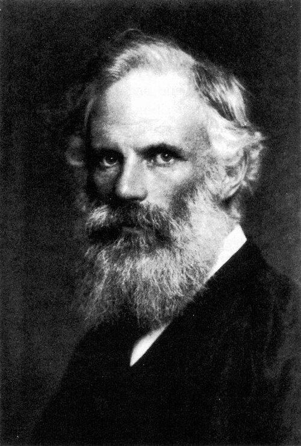

# 乔治·弗朗西斯·菲茨杰拉德

**英文名：** George Francis FitzGerald

**生卒：** 1851年8月3日 — 1901年2月21日

**主要领域：** 电磁学、相对论前史、理论物理

肖像的作者、拍摄或创作年代及具体形式见图片来源。

## 生平简介

爱尔兰理论物理学家，长期在都柏林三一学院任教，是英国麦克斯韦学派的重要成员。他推动电磁波理论与实验联系，并在解释以太漂移实验时提出运动方向长度收缩的假说。

## 对物理的主要贡献

- 较早提出可由振荡电流产生电磁波的方案
- 提出运动物体沿运动方向收缩的假说，后来与洛伦兹的工作共同构成相对论前史
- 推广麦克斯韦电磁场理论并研究辐射问题

## 肖像来源与许可

- 来源：[George_Francis_FitzGerald.jpg](https://commons.wikimedia.org/wiki/File:George_Francis_FitzGerald.jpg)
- 作者／署名：Hollinger and Rockey photographers, New York.
- 许可：Public domain
- 本地文件：[8096717609fe15a3d3b1.jpg](../portraits/8096717609fe15a3d3b1.jpg)
- 原始来源说明：Scanned from Oliver Heaviside: Sage in Solitude (ISBN 0-87942-238-6), p. 48. It was scanned on an Epson Perfection 1250 at 400dpi, reduced to grayscale in Photoshop, and saved as JPG using the 'Save for Web' optimizer. Originally uploaded to en.wikipedia on 20:51, 27 July 2004 by Grendelkhan.

## 资料来源

- [George Francis FitzGerald — Wikipedia（生卒日期与人物概述）](https://en.wikipedia.org/wiki/George_Francis_FitzGerald)

资料整理日期：2026-10-26。
