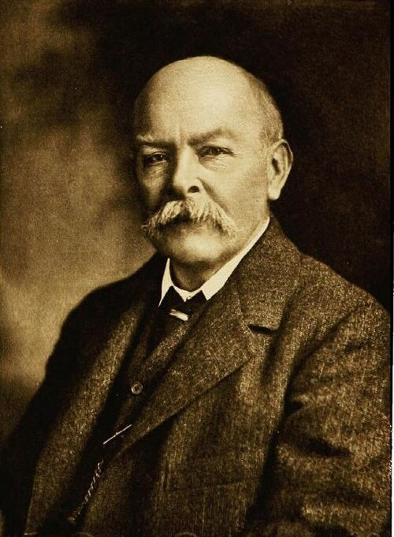

# 约翰·亨利·坡印廷

**英文名：** John Henry Poynting

**生卒：** 1852年9月9日 — 1914年3月30日

**主要领域：** 电磁学、辐射物理、引力实验

肖像的作者、拍摄或创作年代及具体形式见图片来源。

## 生平简介

英国物理学家，长期在伯明翰梅森学院及其后的伯明翰大学任教。他研究电磁能量传输、辐射压与地球密度，通过理论分析与精密测量揭示场如何携带能量，是经典电磁学发展的重要人物。

## 对物理的主要贡献

- 提出描述电磁能流密度的坡印廷矢量和能量守恒定理
- 研究光的辐射压及其对小天体运动的影响
- 开展精密引力实验并测量地球平均密度

## 肖像来源与许可

- 来源：[John_Henry_Poynting.jpg](https://commons.wikimedia.org/wiki/File:John_Henry_Poynting.jpg)
- 作者／署名：见原图页面
- 许可：Public domain
- 本地文件：[c3be30a2393998b190f1.jpg](../portraits/c3be30a2393998b190f1.jpg)
- 原始来源说明：from Oliver Heaviside: Sage in Solitude (ISBN 0-87942-238-6), p. 117.

## 资料来源

- [John Henry Poynting — Wikipedia（生卒日期与人物概述）](https://en.wikipedia.org/wiki/John_Henry_Poynting)

资料整理日期：2026-10-26。
