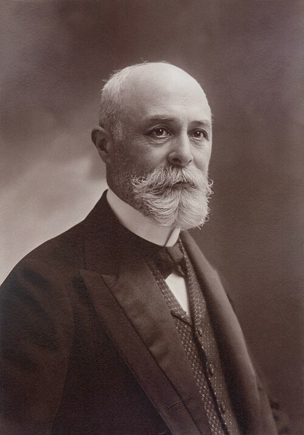

# 亨利·贝克勒尔

**英文名：** Antoine Henri Becquerel

**生卒：** 1852年12月15日 — 1908年8月25日

**主要领域：** 放射性、核物理

肖像的作者、拍摄或创作年代及具体形式见图片来源。

## 生平简介

亨利·贝克勒尔出生于Paris, France，主要从事放射性、核物理研究。诺贝尔奖资料所列获奖时任职机构为École Polytechnique。其代表成果包括发现铀盐在没有外部光照时仍能发出穿透性辐射，获1903年诺贝尔物理学奖。

## 对物理的主要贡献

- 发现铀盐在没有外部光照时仍能发出穿透性辐射
- 由此揭示物质的自发放射性

**诺贝尔物理学奖：** 1903

## 肖像来源与许可

- 来源：[Paul_Nadar_-_Henri_Becquerel.jpg](https://commons.wikimedia.org/wiki/File:Paul_Nadar_-_Henri_Becquerel.jpg)
- 作者／署名：Paul Nadar (1856–1939)
- 许可：[Public domain](https://commons.wikimedia.org/wiki/File:Paul_Nadar_-_Henri_Becquerel.jpg)
- 本地文件：[7ed1eed949a217ed2496.jpg](../portraits/7ed1eed949a217ed2496.jpg)

## 资料来源

- [Henri Becquerel - Facts](https://www.nobelprize.org/prizes/physics/1903/becquerel/facts/)
- [Nobel Prize official laureate API, id 4](https://api.nobelprize.org/2.1/laureate/4)
- [Wikipedia: Henri Becquerel](https://en.wikipedia.org/wiki/Henri_Becquerel)

资料整理日期：2026-10-26。
