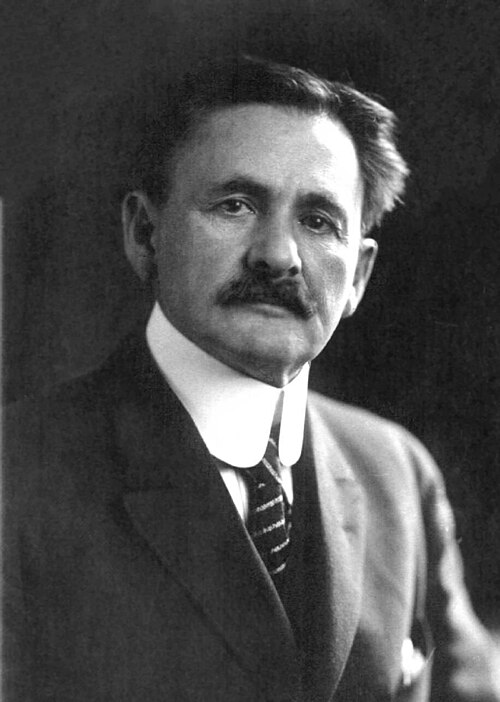

# 阿尔伯特·迈克耳孙

**英文名：** Albert Abraham Michelson

**生卒：** 1852年12月19日 — 1931年5月9日

**主要领域：** 光学、精密测量

肖像的作者、拍摄或创作年代及具体形式见图片来源。

## 生平简介

阿尔伯特·迈克耳孙出生于Strelno, Prussia (now Strzelno, Poland)，主要从事光学、精密测量研究。诺贝尔奖资料所列获奖时任职机构为University of Chicago。其代表成果包括发展高精度干涉测量仪器与方法，获1907年诺贝尔物理学奖。

## 对物理的主要贡献

- 发展高精度干涉测量仪器与方法
- 利用精密光学测量研究光速及光谱

**诺贝尔物理学奖：** 1907

## 肖像来源与许可

- 来源：[Albert_Abraham_Michelson2.jpg](https://commons.wikimedia.org/wiki/File:Albert_Abraham_Michelson2.jpg)
- 作者／署名：The original uploader was Bunzil at English Wikipedia.
- 许可：Public domain
- 本地文件：[56c8f744c268bdfe4046.jpg](../portraits/56c8f744c268bdfe4046.jpg)
- 原始来源说明：Photograph is a higher quality version of the public domain image available from AstroLab or Smithsonian Institution. See Wikipedia:WP:Public_domain#Derived_works_and_restorations_of_works_in_the_public_domain

## 资料来源

- [Albert A. Michelson - Facts](https://www.nobelprize.org/prizes/physics/1907/michelson/facts/)
- [Nobel Prize official laureate API, id 11](https://api.nobelprize.org/2.1/laureate/11)
- [Wikipedia: Albert Abraham Michelson](https://en.wikipedia.org/wiki/Albert_Abraham_Michelson)

资料整理日期：2026-10-26。
