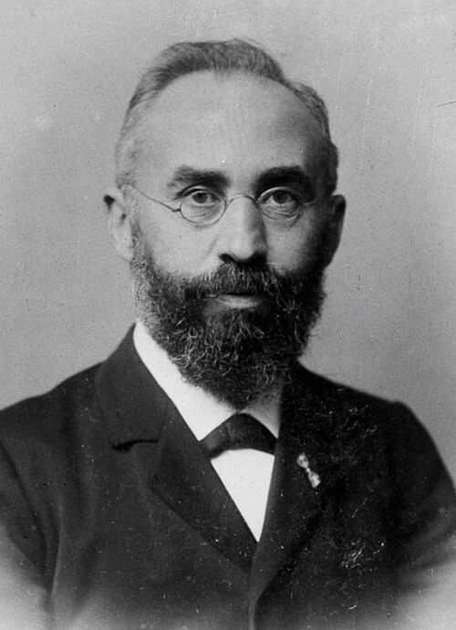

# 亨德里克·洛伦兹

**英文名：** Hendrik Antoon Lorentz

**生卒：** 1853年7月18日 — 1928年2月4日

**主要领域：** 电磁学、相对论

肖像的作者、拍摄或创作年代及具体形式见图片来源。

## 生平简介

亨德里克·洛伦兹出生于Arnhem, the Netherlands，主要从事电磁学、相对论研究。诺贝尔奖资料所列获奖时任职机构为Leiden University。其代表成果包括建立以电子为基础的物质电磁理论，解释磁场对辐射的影响，获1902年诺贝尔物理学奖。

## 对物理的主要贡献

- 建立以电子为基础的物质电磁理论，解释磁场对辐射的影响
- 发展洛伦兹变换，为狭义相对论的形成提供重要数学基础

**诺贝尔物理学奖：** 1902

## 肖像来源与许可

- 来源：[Nobelprijswinnaars._H.A._Lorentz_(cropped).jpg](https://commons.wikimedia.org/wiki/File:Nobelprijswinnaars._H.A._Lorentz_%28cropped%29.jpg)
- 作者／署名：Unknown author
- 许可：PDM-owner
- 本地文件：[9808ba2b76937773fd87.jpg](../portraits/9808ba2b76937773fd87.jpg)
- 原始来源说明：http://hdl.handle.net/10648/ad887254-d0b4-102d-bcf8-003048976d84

## 资料来源

- [Hendrik A. Lorentz - Facts](https://www.nobelprize.org/prizes/physics/1902/lorentz/facts/)
- [Nobel Prize official laureate API, id 2](https://api.nobelprize.org/2.1/laureate/2)
- [Wikipedia: Hendrik Lorentz](https://en.wikipedia.org/wiki/Hendrik_Lorentz)

资料整理日期：2026-10-26。
