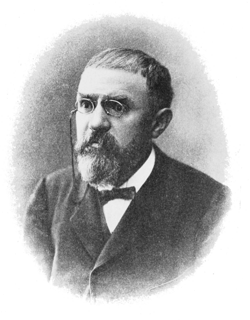

# 亨利·庞加莱

**英文名：** Henri Poincaré

**生卒：** 1854年4月29日 — 1912年7月17日

**主要领域：** 数学物理、天体力学、相对论前史

肖像的作者、拍摄或创作年代及具体形式见图片来源。

## 生平简介

法国数学家和理论物理学家，长期在巴黎工作。他研究天体力学、拓扑、微分方程和电动力学，在复杂动力系统及相对论形成前夕作出重要贡献；同时以科学哲学著作讨论约定、测量和理论结构。

## 对物理的主要贡献

- 揭示三体问题的复杂动力学，奠定定性动力系统和混沌研究的基础
- 研究洛伦兹变换的群性质及相对性原理，参与狭义相对论形成的前史
- 研究电磁理论与天体力学，发展数学物理方法

## 肖像来源与许可

- 来源：[PSM_V82_D416_Henri_Poincare.png](https://commons.wikimedia.org/wiki/File:PSM_V82_D416_Henri_Poincare.png)
- 作者／署名：Unknown author
- 许可：Public domain
- 本地文件：[1626f498e776582a8146.png](../portraits/1626f498e776582a8146.png)
- 原始来源说明：Popular Science Monthly Volume 82

## 资料来源

- [Henri Poincaré — MacTutor, University of St Andrews](https://mathshistory.st-andrews.ac.uk/Biographies/Poincare/)
- [Henri Poincaré — Wikipedia（生卒日期与人物概述）](https://en.wikipedia.org/wiki/Henri_Poincar%C3%A9)

资料整理日期：2026-10-26。
