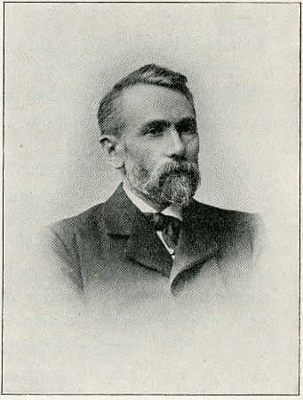

# 亨德里克·威廉·巴克豪斯·罗泽布姆

**英文名：** Hendrik Willem Bakhuis Roozeboom

**生卒：** 1854年10月24日 — 1907年2月8日

**主要领域：** 热力学、相平衡、物理化学

肖像的作者、拍摄或创作年代及具体形式见图片来源。

## 生平简介

荷兰物理化学家，曾在莱顿研究，后任阿姆斯特丹大学教授。他将吉布斯相律用于实际多组分体系，系统整理温度、压强和组成对相平衡的影响，使抽象热力学成为可用的材料研究方法。

## 对物理的主要贡献

- 系统应用吉布斯相律分析多相平衡
- 研究固液平衡、固溶体与多组分相图
- 推动相变热力学在化学和材料研究中的应用

## 肖像来源与许可

- 来源：[Hendrik_Willem_Bakhuis_Roozeboom.jpg](https://commons.wikimedia.org/wiki/File:Hendrik_Willem_Bakhuis_Roozeboom.jpg)
- 作者／署名：Unknown photographer
- 许可：[Public domain](https://commons.wikimedia.org/wiki/File:Hendrik_Willem_Bakhuis_Roozeboom.jpg)
- 本地文件：[c47d5f724b11812ae1e3-58628bb647.jpg](../portraits/c47d5f724b11812ae1e3-58628bb647.jpg)
- 原始来源说明：Biografieën Nederlandse chemici

## 资料来源

- [Bakhuis Roozeboom Medal: phase theory legacy — Royal Netherlands Academy](https://storage.knaw.nl/2023-03/Bakuis-Roozeboom-Medal-regulations.pdf)
- [Hendrik Willem Bakhuis Roozeboom — Wikipedia biography](https://en.wikipedia.org/wiki/Hendrik_Willem_Bakhuis_Roozeboom)

资料整理日期：2026-10-26。
