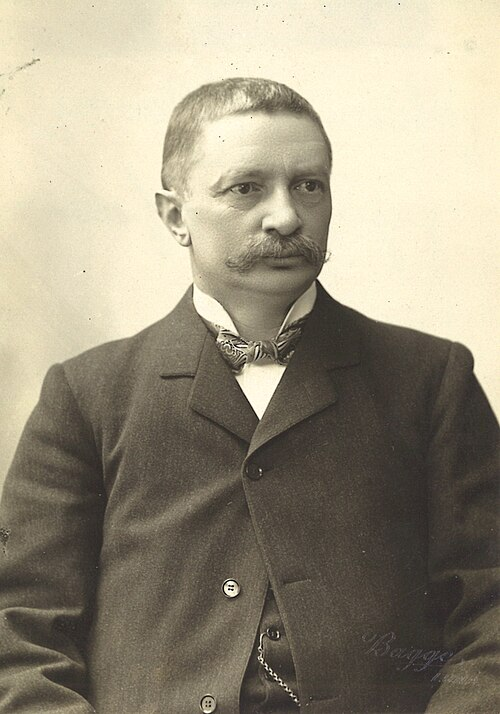

# 约翰内斯·里德伯

**英文名：** Johannes Rydberg

**生卒：** 1854年11月8日 — 1919年12月28日

**主要领域：** 原子光谱、原子结构、数学物理

肖像的作者、拍摄或创作年代及具体形式见图片来源。

## 生平简介

瑞典物理学家，长期在隆德大学工作，早年接受数学训练。他比较不同元素的光谱线，用统一的波数公式整理复杂数据，使原子光谱在量子理论建立之前呈现出重要的系统规律。

## 对物理的主要贡献

- 提出以波数表示原子光谱系列的里德伯公式
- 建立跨元素比较谱线的系统方法及里德伯常数
- 为后来的能级结构、里兹组合原理与量子原子模型提供经验基础

## 肖像来源与许可

- 来源：[Rydberg,_Janne_(foto_Per_Bagge;_AFs_Arkiv).jpg](https://commons.wikimedia.org/wiki/File:Rydberg%2C_Janne_%28foto_Per_Bagge%3B_AFs_Arkiv%29.jpg)
- 作者／署名：sv:Per Bagge (1866–1936)
- 许可：[Public domain](https://commons.wikimedia.org/wiki/File:Rydberg%2C_Janne_%28foto_Per_Bagge%3B_AFs_Arkiv%29.jpg)
- 本地文件：[36a1f99b61411b86323d-98dbdfeb75.jpg](../portraits/36a1f99b61411b86323d-98dbdfeb75.jpg)
- 原始来源说明：Original photograph in the collections of sv:Akademiska Föreningens Arkiv & Studentmuseum (The Archives and Museum of the Academic Society) in Lund, Sweden.

## 资料来源

- [Johannes Rydberg — MacTutor, University of St Andrews](https://mathshistory.st-andrews.ac.uk/Biographies/Rydberg/)
- [Johannes Rydberg — Wikipedia biography](https://en.wikipedia.org/wiki/Johannes_Rydberg)

资料整理日期：2026-10-26。
