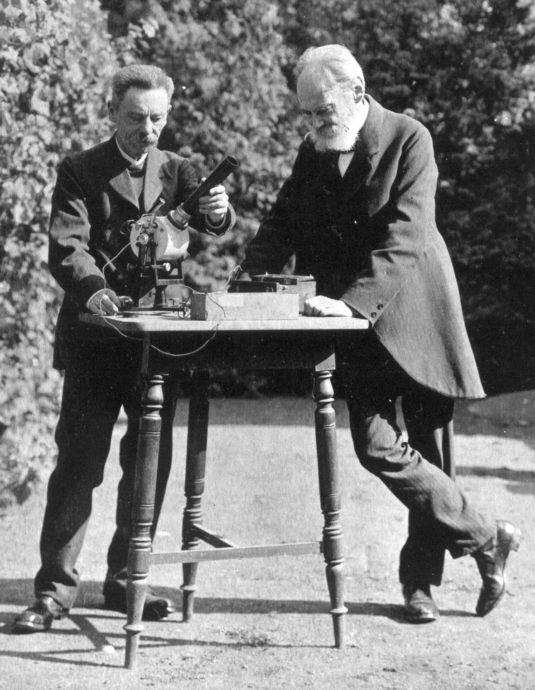

# 尤利乌斯·埃尔斯特

**英文名：** Julius Elster

**生卒：** 1854年12月24日 — 1920年4月8日

**主要领域：** 光电效应、大气电学、放射性

埃尔斯特与盖特尔进行实验的历史双人照片，原样提取自Fricke与Schlegel2017年论文图1；不是单人头像。

## 生平简介

德国物理学家和中学教师，在沃尔芬比特尔与童年好友汉斯·盖特尔长期合作，利用课余时间建立实验研究。他们研究光电效应、大气电与放射性，显示中学教师也能作出重要的基础物理贡献。

## 对物理的主要贡献

- 与盖特尔发展高灵敏光电池和光电测量技术
- 研究空气电离、大气电及降水的电荷
- 实验研究放射性并讨论其原子内部能量来源

## 史料说明

- 逝世日期采用《新德意志人物传记》的1920年4月8日；英文维基及部分转述资料写为4月6日。

## 肖像来源与许可

- 来源：[audit19-elster-geitel-face-000.jpg](https://hgss.copernicus.org/articles/8/1/2017/)
- 作者／署名：见原图页面
- 许可：[CC BY 3.0 (article); historical photo credited Archiv Fricke, see source](https://creativecommons.org/licenses/by/3.0/)
- 本地文件：[cf1d3f302cfec4399fdf-854111e37f.jpg](../portraits/cf1d3f302cfec4399fdf-854111e37f.jpg)
- 原始来源说明：Fricke and Schlegel 2017, Figure 1; photo Archiv Fricke

## 资料来源

- [Julius Elster — Neue Deutsche Biographie](https://www.deutsche-biographie.de/sfz13120.html)
- [Julius Elster — Wikipedia biography](https://en.wikipedia.org/wiki/Julius_Elster)
- [Julius Elster and Hans Geitel — History of Geo- and Space Sciences (2017)](https://hgss.copernicus.org/articles/8/1/2017/)

资料整理日期：2026-10-26。
