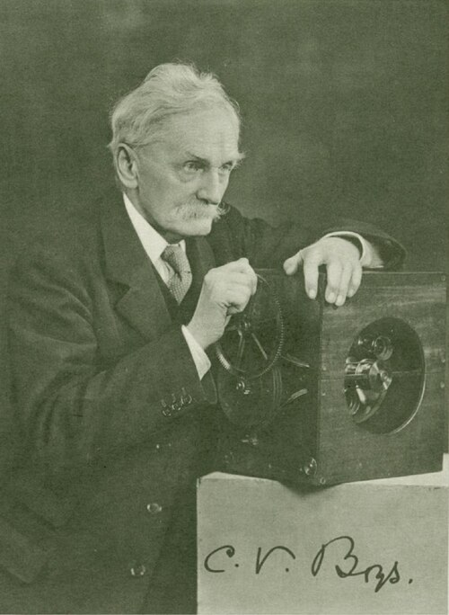

# 查尔斯·弗农·博伊斯

**英文名：** C. V. Boys

**生卒：** 1855年3月15日 — 1944年3月30日

**主要领域：** 精密测量、引力实验、表面物理

肖像的作者、拍摄或创作年代及具体形式见图片来源。

## 生平简介

英国实验物理学家，以制作灵敏仪器和精密测量著称，曾在伦敦任教。他发展极细石英丝悬挂技术，用于微小力矩与引力测量，也研究肥皂泡和高速摄影，善于把实验技巧转化为定量科学工具。

## 对物理的主要贡献

- 发展石英丝悬挂技术，大幅提高扭秤等仪器的灵敏度
- 改进卡文迪许式引力实验，测量万有引力常数
- 研制辐射测量和高速摄影装置，研究表面张力现象

## 肖像来源与许可

- 来源：[CVBoys.jpg](https://commons.wikimedia.org/wiki/File:CVBoys.jpg)
- 作者／署名：A. C. Cooper
- 许可：Public domain
- 本地文件：[07c57f98d43a28b469c1.jpg](../portraits/07c57f98d43a28b469c1.jpg)
- 原始来源说明：Used in the menu card for the dinner of the Royal Society Club in honour of Boys's 80th birthday, 1935. Reproduced in Obituary Notices of Fellows of the Royal Society, Vol. 4, No. 13 (Nov., 1944), p. 772.

## 资料来源

- [C. V. Boys — MacTutor, University of St Andrews](https://mathshistory.st-andrews.ac.uk/Biographies/Boys/)
- [C. V. Boys — Wikipedia（生卒日期与人物概述）](https://en.wikipedia.org/wiki/C._V._Boys)

资料整理日期：2026-10-26。
