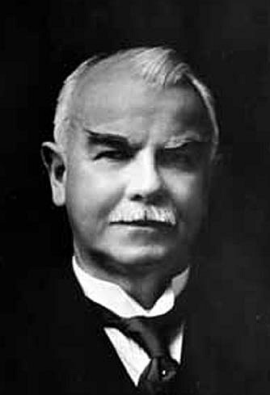

# 詹姆斯·阿尔弗雷德·尤因

**英文名：** James Alfred Ewing

**生卒：** 1855年3月27日 — 1935年1月7日

**主要领域：** 磁学、地球物理、工程物理

肖像的作者、拍摄或创作年代及具体形式见图片来源。

## 生平简介

苏格兰工程师和物理学家，曾赴日本从事工程教育，后在邓迪、剑桥和爱丁堡工作。他研究铁磁材料的磁化过程、地震测量和机械工程，将实验物理与仪器设计及工业问题紧密联系。

## 对物理的主要贡献

- 系统研究铁磁材料磁化的滞后现象，并推广磁滞概念
- 研究磁性材料的微观模型及能量损耗
- 参与发展早期地震记录仪和工程物理教育

## 肖像来源与许可

- 来源：[James_A_Ewing_1855-1835.jpg](https://commons.wikimedia.org/wiki/File:James_A_Ewing_1855-1835.jpg)
- 作者／署名：Unknown author
- 许可：[Public domain](https://commons.wikimedia.org/wiki/File:James_A_Ewing_1855-1835.jpg)
- 本地文件：[7e95284d8affd11c441d.jpg](../portraits/7e95284d8affd11c441d.jpg)
- 原始来源说明：National Science Museum, Tokyo Archived here: https://web.archive.org/web/20090113201403/http://research.kahaku.go.jp/rikou/namazu/02keiki/a/03_06t1.html

## 资料来源

- [James Alfred Ewing — Wikipedia（生卒日期与人物概述）](https://en.wikipedia.org/wiki/James_Alfred_Ewing)

资料整理日期：2026-10-26。
