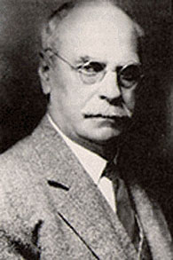

# 埃德温·霍尔

**英文名：** Edwin Hall

**生卒：** 1855年11月7日 — 1938年11月20日

**主要领域：** 电子输运、电磁学、凝聚态物理

肖像的作者、拍摄或创作年代及具体形式见图片来源。

## 生平简介

美国实验物理学家，研究生时期在约翰斯·霍普金斯大学发现霍尔效应，后来长期在哈佛任教。他研究金属在电场、磁场和温度梯度共同作用下的输运，连接经典实验与电子理论的发展。

## 对物理的主要贡献

- 发现载流导体在横向磁场中产生横向电压的霍尔效应
- 研究金属电导和热电、热磁输运性质
- 为测量载流子性质及后来的半导体和量子输运研究提供基础实验效应

## 肖像来源与许可

- 来源：[Edwin_Herbert_Hall_(1855-1938).jpg](https://commons.wikimedia.org/wiki/File:Edwin_Herbert_Hall_%281855-1938%29.jpg)
- 作者／署名：Unknown author
- 许可：[Public domain](https://commons.wikimedia.org/wiki/File:Edwin_Herbert_Hall_%281855-1938%29.jpg)
- 本地文件：[aa74d6723b286a9cef84-89eff70d09.jpg](../portraits/aa74d6723b286a9cef84-89eff70d09.jpg)
- 原始来源说明：page link direct link (down)

## 资料来源

- [Elucidating the Hall Effect — American Physical Society](https://www.aps.org/apsnews/1998/12/elucidating-the-hall-effect)
- [Edwin Hall — Wikipedia biography](https://en.wikipedia.org/wiki/Edwin_Hall)

资料整理日期：2026-10-26。
