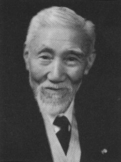

# 田中馆爱橘

**英文名：** Aikitsu Tanakadate

**生卒：** 1856年9月18日 — 1952年5月21日

**主要领域：** 地球物理、计量学、实验物理

肖像的作者、拍摄或创作年代及具体形式见图片来源。

## 生平简介

日本物理学家和地球物理学家，曾在东京大学任教，赴欧美学习物理并组织日本地磁与重力测量。他推动精密观测、国际科学合作和近代物理教育，也参与航空相关研究与科学制度建设。

## 对物理的主要贡献

- 组织日本全国地磁测量，建立系统的地球磁场资料
- 研究重力测量及地球物理观测仪器
- 推动日本近代实验物理、航空研究及国际计量合作

## 肖像来源与许可

- 来源：[Tanakadate_Aikitsu_2.jpg](https://commons.wikimedia.org/wiki/File:Tanakadate_Aikitsu_2.jpg)
- 作者／署名：Unknown author
- 许可：Public domain
- 本地文件：[a6d7efbf75658605c8d2.jpg](../portraits/a6d7efbf75658605c8d2.jpg)
- 原始来源说明：Katalog

## 资料来源

- [Aikitsu Tanakadate — Wikipedia（生卒日期与人物概述）](https://en.wikipedia.org/wiki/Aikitsu_Tanakadate)

资料整理日期：2026-10-26。
