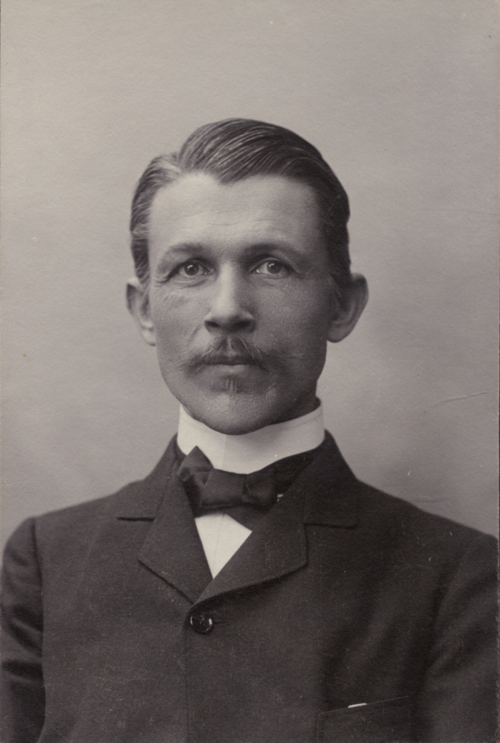

# 克努特·埃格斯特朗

**英文名：** Knut Ångström

**生卒：** 1857年1月12日 — 1910年3月4日

**主要领域：** 太阳物理、大气物理、辐射测量

肖像的作者、拍摄或创作年代及具体形式见图片来源。

## 生平简介

瑞典实验物理学家，安德斯·约纳斯·埃格斯特朗之子，曾在斯德哥尔摩和乌普萨拉工作。他研究太阳辐射和大气吸收，擅长设计测量仪器，并参与建设乌普萨拉新的物理研究设施。

## 对物理的主要贡献

- 研制电补偿式日射强度计，用于直接太阳辐射的精密测量
- 测量太阳常数及高山地区太阳辐射
- 研究水汽、二氧化碳等对红外辐射的吸收

## 肖像来源与许可

- 来源：[Knut_Ångström.png](https://commons.wikimedia.org/wiki/File:Knut_%C3%85ngstr%C3%B6m.png)
- 作者／署名：Henri Osti (1826–1914)
- 许可：[Public domain](https://commons.wikimedia.org/wiki/File:Knut_%C3%85ngstr%C3%B6m.png)
- 本地文件：[d4b97e4e6d528e6e8255-4b2f13e923.png](../portraits/d4b97e4e6d528e6e8255-4b2f13e923.png)
- 原始来源说明：Uppsala universitetsbibliotek

## 资料来源

- [Anders and Knut Ångström — Uppsala University](https://www.uu.se/campus/angstromlaboratoriet/om-oss/historik/anders-och-knut-angstrom)
- [Knut Ångström — Wikipedia biography](https://en.wikipedia.org/wiki/Knut_%C3%85ngstr%C3%B6m)

资料整理日期：2026-10-26。
