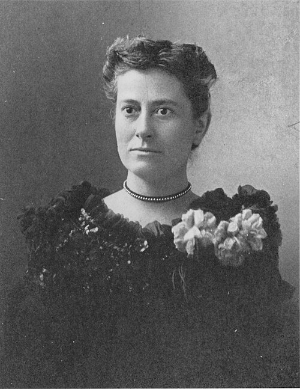

# 威廉敏娜·弗莱明

**英文名：** Williamina Fleming

**生卒：** 1857年5月15日 — 1911年5月21日

**主要领域：** 恒星物理、光谱学、观测天文学

肖像的作者、拍摄或创作年代及具体形式见图片来源。

## 生平简介

苏格兰出生的美国天文学家，移居美国后进入哈佛大学天文台，从事照相底片和光谱分类工作，后来管理女性计算员团队。她凭借大量细致的观测整理，推动恒星光谱分类和变星、新星的发现。

## 对物理的主要贡献

- 建立早期哈佛恒星光谱分类方案并编制大量恒星目录
- 从天文底片中发现多颗变星、新星及其他特殊天体
- 参与识别白矮星异常光谱，推动恒星物理特征的研究

## 肖像来源与许可

- 来源：[Williamina_Paton_Stevens_Fleming_circa_1890s.jpg](https://commons.wikimedia.org/wiki/File:Williamina_Paton_Stevens_Fleming_circa_1890s.jpg)
- 作者／署名：Unknown author
- 许可：Public domain
- 本地文件：[77f7fe67f7c2d5d5f8f4.jpg](../portraits/77f7fe67f7c2d5d5f8f4.jpg)
- 原始来源说明：http://www.cfa.harvard.edu/lib/online/almanac/0300c.htm

## 资料来源

- [Williamina Fleming — Wikipedia（生卒日期与人物概述）](https://en.wikipedia.org/wiki/Williamina_Fleming)

资料整理日期：2026-10-26。
