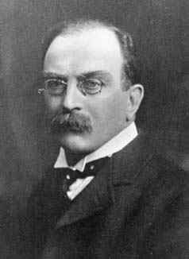

# 约瑟夫·拉莫尔

**英文名：** Joseph Larmor

**生卒：** 1857年7月11日 — 1942年5月19日

**主要领域：** 经典电动力学、磁学、相对论前史

肖像的作者、拍摄或创作年代及具体形式见图片来源。

## 生平简介

爱尔兰出生的理论物理学家，长期在剑桥工作，曾任卢卡斯数学教授。他研究电子理论、电磁辐射和磁场中的带电运动，在经典电动力学与早期相对论的形成过程中提出了多项重要结果。

## 对物理的主要贡献

- 推导加速电荷辐射功率的拉莫尔公式
- 研究磁场中带电体系的拉莫尔进动
- 在电子理论中发展时间变换和运动体系描述，参与相对论形成前史

## 肖像来源与许可

- 来源：[Larmor_2.jpeg](https://mathshistory.st-andrews.ac.uk/Biographies/Larmor/pictdisplay/)
- 作者／署名：摄影者未注明；MacTutor History of Mathematics, University of St Andrews
- 许可：Public domain (historical photograph; same portrait as Commons Joseph Larmor.jpeg)
- 本地文件：[5d9338c5dd18c35f4422-15c84492ce.jpeg](../portraits/5d9338c5dd18c35f4422-15c84492ce.jpeg)

## 资料来源

- [Joseph Larmor — MacTutor, University of St Andrews](https://mathshistory.st-andrews.ac.uk/Biographies/Larmor/)
- [Joseph Larmor — Wikipedia（生卒日期与人物概述）](https://en.wikipedia.org/wiki/Joseph_Larmor)

资料整理日期：2026-10-26。
