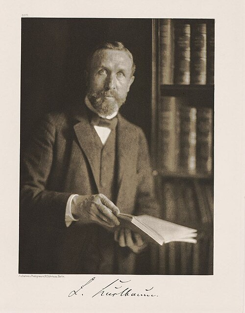

# 费迪南德·库尔鲍姆

**英文名：** Ferdinand Kurlbaum

**生卒：** 1857年10月4日 — 1927年7月29日

**主要领域：** 热辐射、辐射测量、实验技术

肖像的作者、拍摄或创作年代及具体形式见图片来源。

## 生平简介

德国实验物理学家，曾在德国物理技术研究所和柏林技术高校工作。他改进热辐射探测器与绝对测量方法，与鲁本斯等人研究黑体光谱，为二十世纪初辐射理论的检验提供高精度实验资料。

## 对物理的主要贡献

- 改进测辐射热计并发展绝对辐射测量方法
- 与鲁本斯研究长波黑体辐射，提供检验早期辐射公式的重要数据
- 研究黑体辐射功率和高温测量标准

## 肖像来源与许可

- 来源：[Rudolf_Dührkoop_-_Ferdinand_Kurlbaum_(1907)_(KTHzB.jpg](https://commons.wikimedia.org/wiki/File:Rudolf_D%C3%BChrkoop_-_Ferdinand_Kurlbaum_%281907%29_%28KTHzB.jpg)
- 作者／署名：Rudolf Dührkoop (1848–1918)
- 许可：[Public domain](https://commons.wikimedia.org/wiki/File:Rudolf_D%C3%BChrkoop_-_Ferdinand_Kurlbaum_%281907%29_%28KTHzB.jpg)
- 本地文件：[306832212ccb14f911cc-5820a8f343.jpg](../portraits/306832212ccb14f911cc-5820a8f343.jpg)
- 原始来源说明：Rudolf Dührkoop: Die Königliche Technische Hochschule zu Berlin. Kamera-Bildnisse, Berlin 1907

## 资料来源

- [Ferdinand Kurlbaum — Neue Deutsche Biographie](https://www.deutsche-biographie.de/sfz47150.html)
- [Ferdinand Kurlbaum — Wikipedia biography](https://en.wikipedia.org/wiki/Ferdinand_Kurlbaum)

资料整理日期：2026-10-26。
