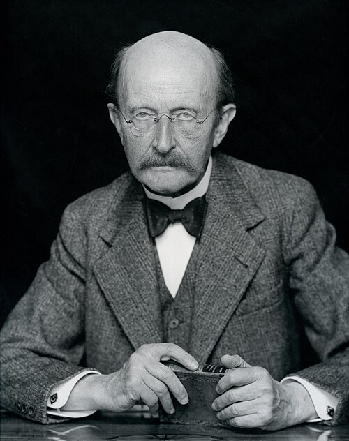

# 马克斯·普朗克

**英文名：** Max Karl Ernst Ludwig Planck

**生卒：** 1858年4月23日 — 1947年10月4日

**主要领域：** 量子论、热辐射

肖像的作者、拍摄或创作年代及具体形式见图片来源。

## 生平简介

马克斯·普朗克出生于Kiel, Schleswig (now Germany)，主要从事量子论、热辐射研究。诺贝尔奖资料所列获奖时任职机构为Berlin University。其代表成果包括提出能量量子假设并建立黑体辐射公式，获1918年诺贝尔物理学奖。

## 对物理的主要贡献

- 提出能量量子假设并建立黑体辐射公式
- 引入普朗克常数，开启量子物理的发展

**诺贝尔物理学奖：** 1918

## 肖像来源与许可

- 来源：[Max_Planck_by_Hugo_Erfurth_1938cr_-_restoration1.jpg](https://commons.wikimedia.org/wiki/File:Max_Planck_by_Hugo_Erfurth_1938cr_-_restoration1.jpg)
- 作者／署名：Hugo Erfurth (1874–1948)
- 许可：[Public domain](https://commons.wikimedia.org/wiki/Commons:Reuse_of_PD-Art_photographs)
- 本地文件：[fa7ebfc852a543ad2579.jpg](../portraits/fa7ebfc852a543ad2579.jpg)
- 原始来源说明：This file was derived from: Max Planck by Hugo Erfurth 1938cr.jpg Original source: https://www.dhm.de/lemo/bestand/objekt/max-planck

## 资料来源

- [Max Planck - Facts](https://www.nobelprize.org/prizes/physics/1918/planck/facts/)
- [Nobel Prize official laureate API, id 23](https://api.nobelprize.org/2.1/laureate/23)
- [Wikipedia: Max Planck](https://en.wikipedia.org/wiki/Max_Planck)

资料整理日期：2026-10-26。
