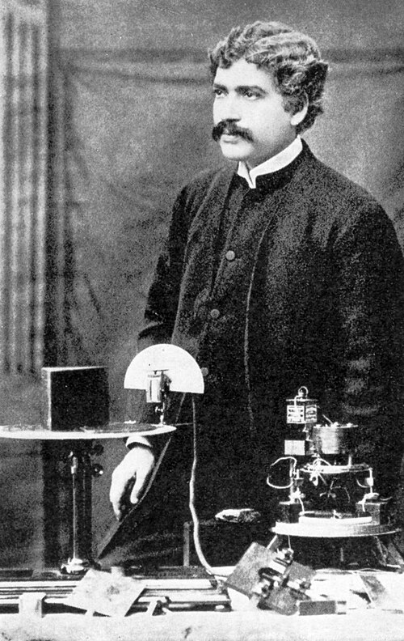

# 贾加迪什·钱德拉·玻色

**英文名：** Jagadish Chandra Bose

**生卒：** 1858年11月30日 — 1937年11月23日

**主要领域：** 微波物理、固态探测、生物物理

肖像的作者、拍摄或创作年代及具体形式见图片来源。

## 生平简介

印度物理学家和跨学科研究者，曾在加尔各答总统学院任教并创立玻色研究所。他在殖民地教育环境中开展毫米波实验，设计灵敏探测器，后来研究植物电响应，对南亚实验科学建设贡献突出。

## 对物理的主要贡献

- 开展毫米波产生、偏振、折射和探测实验，推进微波光学
- 研制半导体接触式无线电探测器，是固态检波研究的先驱之一
- 发展高灵敏仪器研究植物的电学和机械响应

## 肖像来源与许可

- 来源：[J.C.Bose.JPG](https://commons.wikimedia.org/wiki/File:J.C.Bose.JPG)
- 作者／署名：The Birth Centenary Committee, printed by P.C. Ray
- 许可：Public domain
- 本地文件：[882ec2dabeb2831725d6.jpg](../portraits/882ec2dabeb2831725d6.jpg)
- 原始来源说明：Acharya Jagadis Chandra Bose, Birth Centenary

## 资料来源

- [Jagadish Chandra Bose — Wikipedia（生卒日期与人物概述）](https://en.wikipedia.org/wiki/Jagadish_Chandra_Bose)

资料整理日期：2026-10-26。
