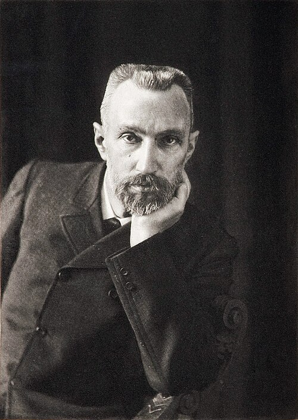

# 皮埃尔·居里

**英文名：** Pierre Curie

**生卒：** 1859年5月15日 — 1906年4月19日

**主要领域：** 放射性、磁性、压电物理

肖像的作者、拍摄或创作年代及具体形式见图片来源。

## 生平简介

皮埃尔·居里出生于Paris, France，主要从事放射性、磁性、压电物理研究。诺贝尔奖资料所列获奖时任职机构为École municipale de physique et de chimie industrielles (Municipal School of Industrial Physics and Chemistry)。其代表成果包括与玛丽·居里共同研究放射性并发现钋和镭，获1903年诺贝尔物理学奖。

## 对物理的主要贡献

- 与玛丽·居里共同研究放射性并发现钋和镭
- 研究磁性中的居里定律，并与雅克·居里发现压电效应

**诺贝尔物理学奖：** 1903

## 肖像来源与许可

- 来源：[Pierre_Curie_by_Dujardin_c1906.jpg](https://commons.wikimedia.org/wiki/File:Pierre_Curie_by_Dujardin_c1906.jpg)
- 作者／署名：Mme P. Curie
- 许可：[Public domain](https://commons.wikimedia.org/wiki/File:Pierre_Curie_by_Dujardin_c1906.jpg)
- 本地文件：[ebdef2af35eeb01895a0.jpg](../portraits/ebdef2af35eeb01895a0.jpg)
- 原始来源说明：Traité de radioactivité Author

## 资料来源

- [Pierre Curie - Facts](https://www.nobelprize.org/prizes/physics/1903/pierre-curie/facts/)
- [Nobel Prize official laureate API, id 5](https://api.nobelprize.org/2.1/laureate/5)
- [Wikipedia: Pierre Curie](https://en.wikipedia.org/wiki/Pierre_Curie)

资料整理日期：2026-10-26。
