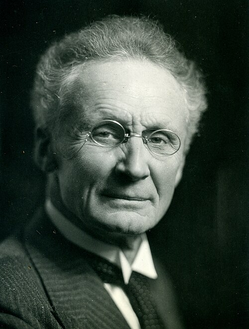

# 威廉·比耶克内斯

**英文名：** Vilhelm Bjerknes

**生卒：** 1862年3月14日 — 1951年4月9日

**主要领域：** 大气物理、流体力学、动力气象学

肖像的作者、拍摄或创作年代及具体形式见图片来源。

## 生平简介

挪威物理学家和气象学家，早年协助父亲研究流体力学，后在斯德哥尔摩、莱比锡及卑尔根等地工作。他把热力学和流体方程用于大气运动，创立卑尔根气象学派，推动天气预报的物理化。

## 对物理的主要贡献

- 把天气预报表述为由观测初值和动力学方程求解的问题
- 发展大气环流和气团、锋面研究的物理基础
- 建立卑尔根气象学派，促进现代动力气象学

## 肖像来源与许可

- 来源：[Vilhelm_Bjerknes_Bust_01.jpg](https://commons.wikimedia.org/wiki/File:Vilhelm_Bjerknes_Bust_01.jpg)
- 作者／署名：Unknown author
- 许可：[CC BY-SA 4.0](https://commons.wikimedia.org/wiki/File:Vilhelm_Bjerknes_Bust_01.jpg)
- 本地文件：[b5ce50b790b66ef28120-25f8c23bc8.jpg](../portraits/b5ce50b790b66ef28120-25f8c23bc8.jpg)
- 原始来源说明：Bjerknes Family

## 资料来源

- [Vilhelm Bjerknes — MacTutor, University of St Andrews](https://mathshistory.st-andrews.ac.uk/Biographies/Bjerknes_Vilhelm/)
- [Vilhelm Bjerknes — Wikipedia biography](https://en.wikipedia.org/wiki/Vilhelm_Bjerknes)

资料整理日期：2026-10-26。
