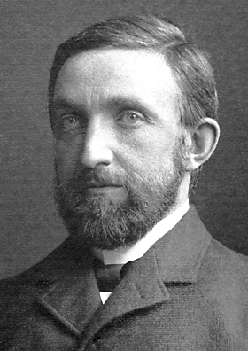

# 菲利普·莱纳德

**英文名：** Philipp Eduard Anton von Lenard

**生卒：** 1862年6月7日 — 1947年5月20日

**主要领域：** 电子物理、实验物理

肖像的作者、拍摄或创作年代及具体形式见图片来源。

## 生平简介

菲利普·莱纳德出生于Pressburg, Hungary (now Bratislava, Slovakia)，主要从事电子物理、实验物理研究。诺贝尔奖资料所列获奖时任职机构为Kiel University。其代表成果包括系统研究阴极射线的穿透、吸收与传播性质，获1905年诺贝尔物理学奖。

## 对物理的主要贡献

- 系统研究阴极射线的穿透、吸收与传播性质
- 为电子束实验研究提供早期实验依据

**诺贝尔物理学奖：** 1905

## 肖像来源与许可

- 来源：[Lenard.jpg](https://commons.wikimedia.org/wiki/File:Lenard.jpg)
- 作者／署名：Unknown author
- 许可：Public domain
- 本地文件：[ef1c8075dff24633d599.jpg](../portraits/ef1c8075dff24633d599.jpg)
- 原始来源说明：http://nobelprize.org/nobel_prizes/physics/laureates/1905/lenard-bio.html

## 资料来源

- [Philipp Lenard - Facts](https://www.nobelprize.org/prizes/physics/1905/lenard/facts/)
- [Nobel Prize official laureate API, id 9](https://api.nobelprize.org/2.1/laureate/9)
- [Wikipedia: Philipp Lenard](https://en.wikipedia.org/wiki/Philipp_Lenard)

资料整理日期：2026-10-26。
