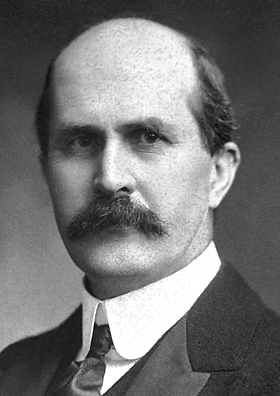

# 威廉·亨利·布拉格

**英文名：** Sir William Henry Bragg

**生卒：** 1862年7月2日 — 1942年3月12日

**主要领域：** 晶体学、X射线

肖像的作者、拍摄或创作年代及具体形式见图片来源。

## 生平简介

威廉·亨利·布拉格出生于Wigton, United Kingdom，主要从事晶体学、X射线研究。诺贝尔奖资料所列获奖时任职机构为University College。其代表成果包括发展X射线光谱仪，并与劳伦斯·布拉格开展晶体结构分析，获1915年诺贝尔物理学奖。

## 对物理的主要贡献

- 发展X射线光谱仪，并与劳伦斯·布拉格开展晶体结构分析
- 建立利用X射线测量晶体结构的实验体系

**诺贝尔物理学奖：** 1915

## 肖像来源与许可

- 来源：[Wh-bragg.jpg](https://commons.wikimedia.org/wiki/File:Wh-bragg.jpg)
- 作者／署名：Nobel foundation
- 许可：Public domain
- 本地文件：[b7b26e48ce6ec80176e6.jpg](../portraits/b7b26e48ce6ec80176e6.jpg)
- 原始来源说明：http://nobelprize.org/nobel_prizes/physics/laureates/1915/wh-bragg-bio.html

## 资料来源

- [William Bragg - Facts](https://www.nobelprize.org/prizes/physics/1915/wh-bragg/facts/)
- [Nobel Prize official laureate API, id 20](https://api.nobelprize.org/2.1/laureate/20)
- [Wikipedia: William Henry Bragg](https://en.wikipedia.org/wiki/William_Henry_Bragg)

资料整理日期：2026-10-26。
