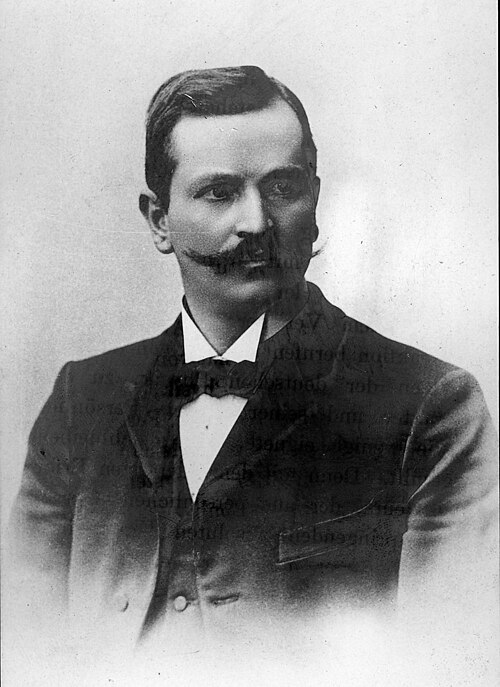

# 保罗·德鲁德

**英文名：** Paul Drude

**生卒：** 1863年7月12日 — 1906年7月5日

**主要领域：** 凝聚态物理、电子输运、光学

肖像的作者、拍摄或创作年代及具体形式见图片来源。

## 生平简介

德国理论与实验物理学家，曾在哥廷根、莱比锡、吉森和柏林工作，并参与编辑重要物理期刊。他把电子运动用于理解金属的电和热输运，同时研究光学，是经典电子理论建立时期的关键人物。

## 对物理的主要贡献

- 提出金属自由电子的德鲁德模型，解释电导率与热导率的基本关系
- 发展金属光学和电磁波传播研究
- 用经典电子碰撞图像建立输运理论，成为后来量子金属理论的比较起点

## 肖像来源与许可

- 来源：[Paul_Drude.jpg](https://commons.wikimedia.org/wiki/File:Paul_Drude.jpg)
- 作者／署名：见原图页面
- 许可：Public domain
- 本地文件：[2a67a20244d82a642906.jpg](../portraits/2a67a20244d82a642906.jpg)

## 资料来源

- [Paul Drude — Wikipedia（生卒日期与人物概述）](https://en.wikipedia.org/wiki/Paul_Drude)

资料整理日期：2026-10-26。
