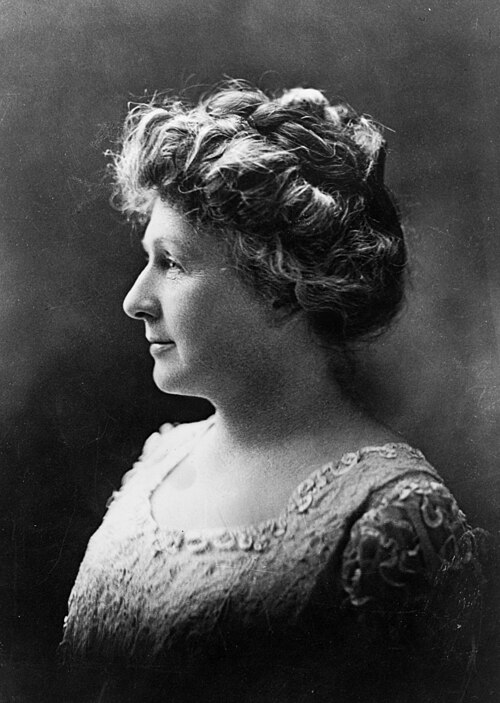

# 安妮·詹普·坎农

**英文名：** Annie Jump Cannon

**生卒：** 1863年12月11日 — 1941年4月13日

**主要领域：** 恒星物理、光谱学、观测天文学

肖像的作者、拍摄或创作年代及具体形式见图片来源。

## 生平简介

美国天文学家，长期在哈佛大学天文台从事恒星光谱分类和星表编纂。她凭借熟练的谱线辨认能力处理数十万颗恒星，把早期分类系统整理成按物理性质排列的序列，是现代恒星研究的重要基础工作者。

## 对物理的主要贡献

- 确立并大规模应用O、B、A、F、G、K、M恒星光谱分类序列
- 主持或参与亨利·德雷珀星表及其扩展工作，提供庞大的标准化光谱资料
- 发现和研究变星，推动恒星群体比较

## 肖像来源与许可

- 来源：[Annie_Jump_Cannon_1922_Portrait.jpg](https://commons.wikimedia.org/wiki/File:Annie_Jump_Cannon_1922_Portrait.jpg)
- 作者／署名：New York World-Telegram and the Sun Newspaper
- 许可：Public domain
- 本地文件：[e91a6652e8c5e85bd267.jpg](../portraits/e91a6652e8c5e85bd267.jpg)
- 原始来源说明：http://www.britannica.com/EBchecked/topic/92776/Annie-Jump-Cannon

## 资料来源

- [Annie Jump Cannon — Wikipedia（生卒日期与人物概述）](https://en.wikipedia.org/wiki/Annie_Jump_Cannon)

资料整理日期：2026-10-26。
