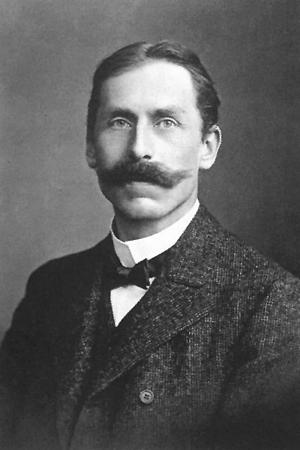

# 弗里德里希·帕邢

**英文名：** Friedrich Paschen

**生卒：** 1865年1月22日 — 1947年2月25日

**主要领域：** 原子光谱、气体放电、精密测量

肖像的作者、拍摄或创作年代及具体形式见图片来源。

## 生平简介

德国实验物理学家，长期从事精密光谱和气体放电研究，曾在图宾根任教并主持德国物理技术研究所。他把谱线测量与外场实验结合，为原子结构和早期量子理论提供重要数据。

## 对物理的主要贡献

- 发现气体击穿电压与压强和间隙乘积有关的帕邢定律
- 发现氢原子红外光谱的帕邢系
- 与巴克研究强磁场中的谱线行为，形成帕邢—巴克效应

## 肖像来源与许可

- 来源：[Friedrich_Paschen_Physiker.jpg](https://commons.wikimedia.org/wiki/File:Friedrich_Paschen_Physiker.jpg)
- 作者／署名：Unknown author
- 许可：[Public domain](https://commons.wikimedia.org/wiki/File:Friedrich_Paschen_Physiker.jpg)
- 本地文件：[6ac4bd80a877e6b0c87d-6498776353.jpg](../portraits/6ac4bd80a877e6b0c87d-6498776353.jpg)
- 原始来源说明：www.maerkischeallgemeine.de

## 资料来源

- [Friedrich Paschen — Neue Deutsche Biographie](https://www.deutsche-biographie.de/gnd11889210X.html)
- [Friedrich Paschen — Wikipedia biography](https://en.wikipedia.org/wiki/Friedrich_Paschen)

资料整理日期：2026-10-26。
