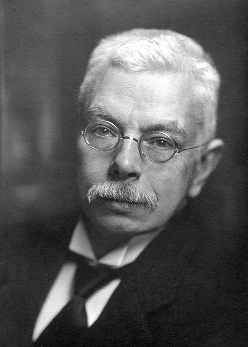

# 彼得·塞曼

**英文名：** Pieter Zeeman

**生卒：** 1865年5月25日 — 1943年10月9日

**主要领域：** 光谱学、电磁学

肖像的作者、拍摄或创作年代及具体形式见图片来源。

## 生平简介

彼得·塞曼出生于Zonnemaire, the Netherlands，主要从事光谱学、电磁学研究。诺贝尔奖资料所列获奖时任职机构为Amsterdam University。其代表成果包括发现磁场使原子光谱线分裂的塞曼效应，获1902年诺贝尔物理学奖。

## 对物理的主要贡献

- 发现磁场使原子光谱线分裂的塞曼效应
- 利用光谱实验揭示原子辐射与磁场的关系

**诺贝尔物理学奖：** 1902

## 肖像来源与许可

- 来源：[Pieter_Zeeman.jpg](https://commons.wikimedia.org/wiki/File:Pieter_Zeeman.jpg)
- 作者／署名：Unknown author
- 许可：[Public domain](https://commons.wikimedia.org/wiki/File:Pieter_Zeeman.jpg)
- 本地文件：[c7b2134ca5f6f557fe97.jpg](../portraits/c7b2134ca5f6f557fe97.jpg)
- 原始来源说明：http://he.wikipedia.org/wiki/Image:Zeeman.jpg

## 资料来源

- [Pieter Zeeman - Facts](https://www.nobelprize.org/prizes/physics/1902/zeeman/facts/)
- [Nobel Prize official laureate API, id 3](https://api.nobelprize.org/2.1/laureate/3)
- [Wikipedia: Pieter Zeeman](https://en.wikipedia.org/wiki/Pieter_Zeeman)

资料整理日期：2026-10-26。
