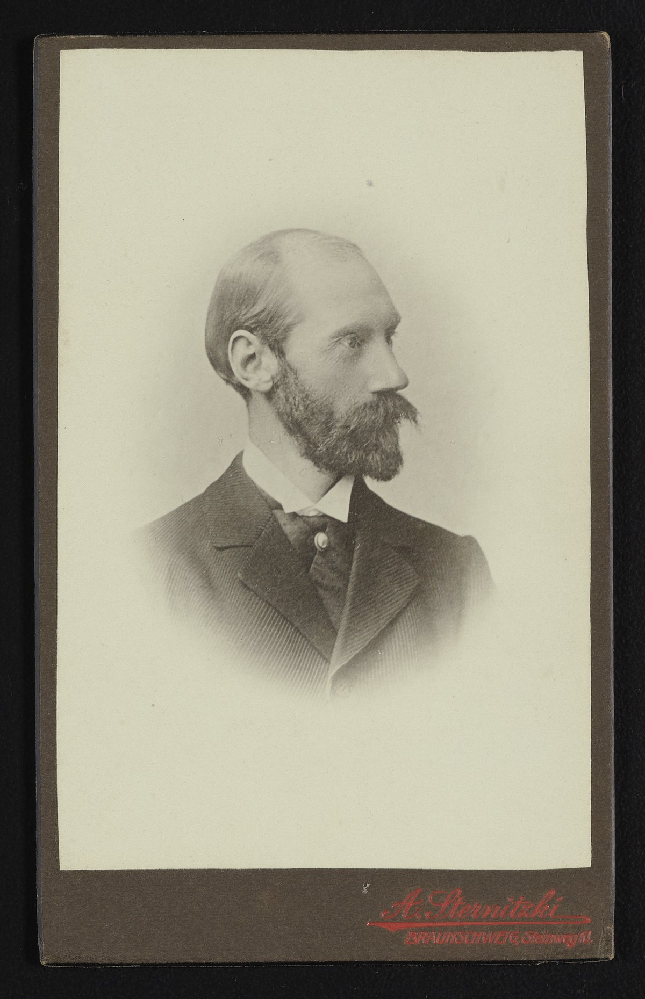

# 弗里德里希·波克尔斯

**英文名：** Friedrich Pockels

**生卒：** 1865年6月18日 — 1913年8月29日

**主要领域：** 晶体光学、电光效应、凝聚态物理

约1900年的弗里德里希·波克尔斯肖像照片，由A.Sternitzki在不伦瑞克摄制。Science History Institute档案明确识别被摄人为1865–1913年的海德堡物理学家。

## 生平简介

德国理论与实验物理学家，曾在哥廷根和海德堡工作。他研究晶体的光学、电学和热学性质，把对称性分析用于外场作用下的光传播；其妹妹阿格妮丝亦以表面物理实验著称。

## 对物理的主要贡献

- 研究电场引起晶体折射率线性变化的波克尔斯效应
- 发展晶体光学与弹光效应的系统理论
- 以晶体对称性分析电光和其他各向异性物理性质

## 肖像来源与许可

- 来源：[download_medium](https://digital.sciencehistory.org/works/ie5dlrr)
- 作者／署名：Sternitzki, A.
- 许可：[Public Domain Mark 1.0](https://creativecommons.org/publicdomain/mark/1.0/)
- 本地文件：[8fdc2db91c183fc74a49-f85fa27c3e.jpg](../portraits/8fdc2db91c183fc74a49-f85fa27c3e.jpg)
- 原始来源说明：Courtesy of Science History Institute. Papers of Georg and Max Bredig, Box 21. Circa 1900.

## 资料来源

- [Friedrich Pockels — Wikipedia（生卒日期与人物概述）](https://en.wikipedia.org/wiki/Friedrich_Pockels)

资料整理日期：2026-10-26。
