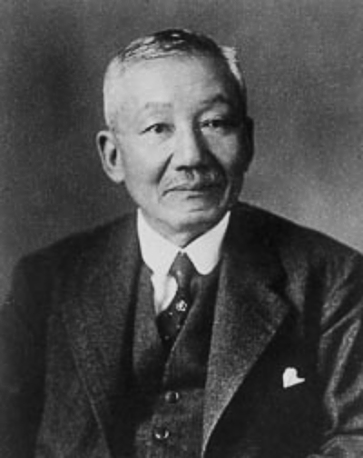

# 长冈半太郎

**英文名：** Hantaro Nagaoka

**生卒：** 1865年8月19日 — 1950年12月11日

**主要领域：** 原子物理、磁学、光谱学

肖像的作者、拍摄或创作年代及具体形式见图片来源。

## 生平简介

日本物理学家，曾赴欧洲学习，长期在东京帝国大学任教，后参与日本科学机构建设。他研究磁学、光谱和原子结构，在核式原子模型确立之前提出土星式原子构想，是近代日本理论物理的重要先驱。

## 对物理的主要贡献

- 提出带正电中心与电子环组成的土星式原子模型
- 研究磁致伸缩、光谱和电磁现象
- 推动日本近代物理研究与高等教育的发展

## 史料说明

- 土星式模型是原子结构探索中的历史模型，并非现代正确原子图像。

## 肖像来源与许可

- 来源：[Hantaro_Nagaoka.jpg](https://commons.wikimedia.org/wiki/File:Hantaro_Nagaoka.jpg)
- 作者／署名：Unknown author
- 许可：Public domain
- 本地文件：[a5afd16a0e6942a1b96d.jpg](../portraits/a5afd16a0e6942a1b96d.jpg)
- 原始来源说明：[1]

## 资料来源

- [Hantaro Nagaoka — Wikipedia（生卒日期与人物概述）](https://en.wikipedia.org/wiki/Hantaro_Nagaoka)

资料整理日期：2026-10-26。
