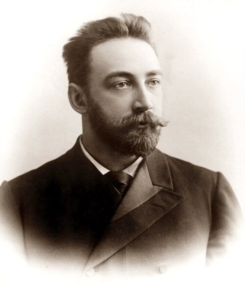

# 彼得·列别捷夫

**英文名：** Pyotr Lebedev

**生卒：** 1866年3月8日 — 1912年3月14日

**主要领域：** 辐射物理、电磁学、精密测量

肖像的作者、拍摄或创作年代及具体形式见图片来源。

## 生平简介

俄国实验物理学家，曾在德国求学，后在莫斯科大学建立研究实验室。他以极灵敏的扭秤研究辐射压力，力求检验电磁场携带动量的理论预言；其团队对俄国实验物理传统的发展影响深远。

## 对物理的主要贡献

- 实验测量光对固体产生的辐射压力，验证电磁辐射动量的预言
- 进一步研究光对气体的压力
- 发展微弱力测量和高灵敏实验技术

## 史料说明

- 俄国历史文献常使用儒略历
- 档案日期按公历列出。
- 公历生卒日期为1866年3月8日及1912年3月14日；旧俄历相应为1866年2月24日及1912年3月1日。

## 肖像来源与许可

- 来源：[Lebedev_petr_nikolaevich.jpg](https://commons.wikimedia.org/wiki/File:Lebedev_petr_nikolaevich.jpg)
- 作者／署名：Unknown author
- 许可：Public domain
- 本地文件：[4d54a8d403a91866e7a4.jpg](../portraits/4d54a8d403a91866e7a4.jpg)
- 原始来源说明：http://slovari.yandex.ru/dict/bse/article/00041/42200.htm?text=%D0%9F%D0%B5%D1%82%D1%80%20%D0%9D%D0%B8%D0%BA%D0%BE%D0%BB%D0%B0%D0%B5%D0%B2%D0%B8%D1%87%20%D0%9B%D0%B5%D0%B1%D0%B5%D0%B4%D0%B5%D0%B2&stpar1=1.1.3

## 资料来源

- [150th anniversary of Petr Nikolaevich Lebedev — Physics-Uspekhi/Russian Academy of Sciences](https://ufn.ru/en/events/lebedev150.html)
- [Pyotr Lebedev — Wikipedia（生卒日期与人物概述）](https://en.wikipedia.org/wiki/Pyotr_Lebedev)

资料整理日期：2026-10-26。
